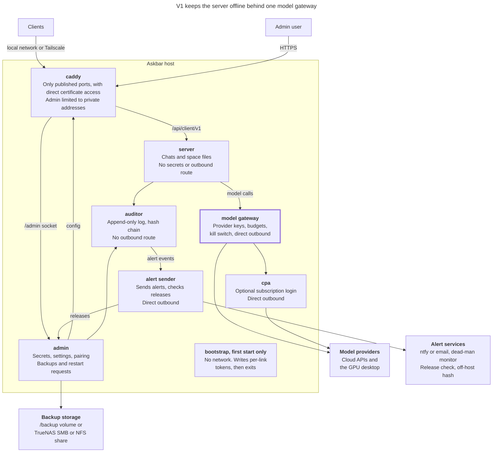
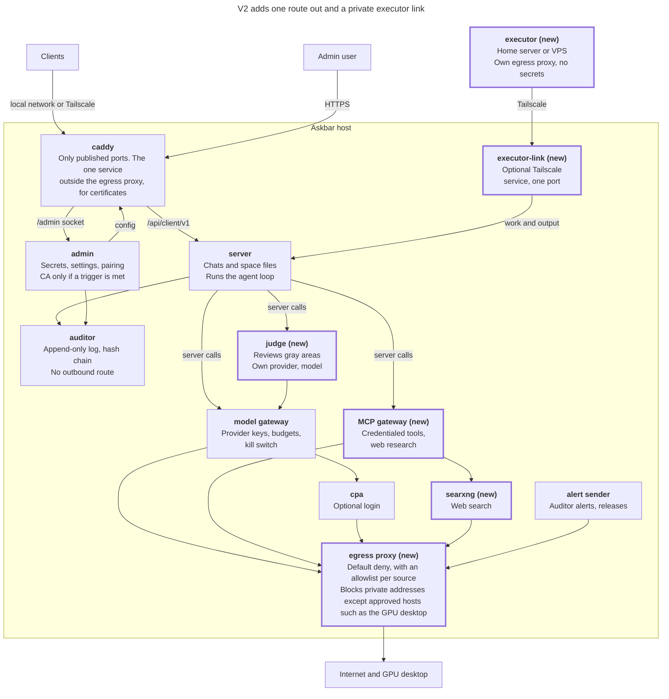

# Askbar Architecture Plan: Clean Copy

Nov 4, 2026 · Jake

> Reference copy of the plan the [ADRs](adr/README.md) were written from. ADR numbers in this plan refer to the earlier ADR set, which has been replaced. For current decisions, see the ADRs; where they differ, the ADRs apply.

## Summary and limits

V1 is 1.0: a conversation-only Askbar that deploys with `docker compose up -d` and is set up in the admin. It uses a one-time bootstrap and per-link tokens, with no CA, controller, or Docker socket. After v1, the egress proxy ships first, followed by web research with the judge, then the executor.

Decision numbers in headings match the original plan. A fresh deployment and one paired client must work end to end to meet the v1 exit test (decision 1). Each step's definition of done includes tests, docs, a rollback, and failure tests where relevant (decision 17).

### Project limits (decisions 14 and 27)

| Limit | Decision | Effect on the plan |
| --- | --- | --- |
| Owner time | 6 hours per week | About 100 hours from now to March 1, 2027 |
| Monthly cost | $20 per month on models or an OAuth subscription, with self-hosted models preferred where possible | Budget caps and provider choices must fit |
| Askbar host | Dedicated headless desktop with 32 to 64 GB of RAM | Setup happens from another machine on the private network |
| Self-hosted models | A separate desktop with a GPU | The model gateway needs a route to it |
| Backup storage | Most likely an SMB or NFS share from a TrueNAS server | Backups leave the Askbar host, but stay on site |
| Target date | Family using it by March 2027 | Anything that doesn't fit moves to a later version |

When work doesn't fit, cut scope instead of exceeding a limit. Estimate each v1 item before work starts, then defer in this order: iOS and memory, mismatch alerts, scheduled backups to multiple destinations, then shared spaces.

### Service targets (decision 15)

Askbar is an open-source project for personal hardware, with no support or uptime guarantee, and the README says so plainly.

| Measure | Project promise | Family target | Test |
| --- | --- | --- | --- |
| Users | No fixed limit; docs state the tested size | 3 active users | 3 simultaneous replies against the mock model |
| Uptime | No guarantee or support | Best effort, and back up after a reboot with no commands | Reboot test |
| Data loss | No guarantee | Up to 24 hours, using a daily backup schedule | Restore drill from a daily backup |
| Recovery from backup | Documented steps | Under 30 minutes on a clean host | Timed drill by a person |
| Service restart | Documented behavior | Under 1 minute from the admin | Scripted restart test |
| Added latency | No guarantee | Under 200 ms at the 95th percentile before the first token, excluding the provider | CI check with the mock model |

## V1 architecture (decisions 2, 3, 5, 12, 13)

V1 runs six long-running services and a small alert sender, plus a one-time bootstrap. No service has the Docker socket, and the server stores no secrets and has no outbound route.

Every service except the admin appends to the auditor with its own token. The admin reads the auditor and pushes configuration and restart requests to each service. The egress proxy stays out of v1, so Caddy, the model gateway, `cpa`, and the alert sender use direct outbound access. `server` keeps its name.

The admin stays on one host name, with no separate hostname switch or admin ingress.

### Bootstrap

`bootstrap` runs before the other services and has no network. It mounts only credential volumes, generates each per-link token, writes it to the caller's volume, and writes its hash to the receiver's volume. It then exits, and the other services start.

Credentials use named volumes instead of Compose file secrets, because those files must exist before startup. Internal service names are fixed in the images or Compose file. Services don't share data volumes.

### First run (decisions 6, 7, 34)

Ownership follows the pfSense model: limit who can reach the admin page. Docker and any DNS or router settings must exist first. A domain is needed only for a passkey, and your instance will use one.

| Area | pfSense | Askbar |
| --- | --- | --- |
| Who can reach it | [Default deny on WAN, default allow on LAN](https://docs.netgate.com/pfsense/en/latest/firewall/best-practices.html) | Private addresses only. The admin can add Tailscale later |
| Encryption | [HTTPS with a self-signed certificate from first boot, and a redirect from port 80](https://docs.netgate.com/pfsense/en/latest/config/advanced-admin.html) | The same |
| First credential | [Default `admin` and `pfsense` login](https://docs.netgate.com/pfsense/en/latest/solutions/netgate-4200/initial-configuration.html), then a wizard password step | Published `admin:admin`, then a wizard password step |
| After setup | [Anti-lockout rules keep the GUI reachable on LAN](https://docs.netgate.com/pfsense/en/latest/config/advanced-admin.html) | Allowlist stays on for private addresses, and can be widened in settings |
| Recovery | [Console options reset the admin account or restore factory defaults](https://docs.netgate.com/pfsense/en/latest/config/console-menu.html) | A host or console command does both, and each reset is recorded in the audit log |

**First-run flow**

1. Run `docker compose up -d`.
2. Open the host's private address over HTTPS, accept the certificate warning, and sign in with `admin:admin`.
3. Change the admin password. Nothing else is allowed until this is done, and the default password or any password matching the username is rejected, following [pfSense Plus](https://redmine.pfsense.org/issues/15266).
4. Set the audit and backup passphrases.
5. Optionally, enter the URL and DNS settings so Caddy can obtain a real certificate.
6. With a domain, optionally create a passkey, which is recommended, and save its recovery codes. The password is then removed. Without a passkey, the admin signs in with the changed password.
7. Add providers and settings.
8. Create a user and generate a pairing key. The user registers a client and starts chatting.

**Address limit:** Caddy checks the connection's real source, never a forwarded header. Test each supported Docker mode, because source addresses can be rewritten. The docs warn that a router or proxy that rewrites the source can make public traffic look private.

### Restarts

The admin asks a service to exit cleanly, and Docker's restart policy starts it again. Each endpoint has authentication, an audit event, a cooldown, a shutdown limit, and restart-loop alerts.

| Service | Restart approach |
| --- | --- |
| `server`, `admin`, model gateway | Built-in self-restart endpoint |
| `caddy` | Live config reload, with no custom endpoint |
| `cpa` | Test its reload behavior first, and add a small supervisor process only if needed |
| `auditor` | Host recovery only |

Services you build also get an internal watchdog, because Docker marks a failed health check unhealthy but doesn't restart the container. A hung service, a failed admin, or the auditor needs host recovery.

### Design requirements

| Area | Requirement | Why it matters |
| --- | --- | --- |
| Component matrix | List what each service holds, what it can reach, and what its compromise exposes. Test it with `check-isolation.sh` | Makes isolation claims checkable |
| Failure table | Record behavior, alerting, and recovery for each service, including a full auditor disk | Fail-closed logging and admin dependence create outage paths |
| Network map | Show every link, including config pushes, audit appends, alerts, and certificate requests | The re-architecture diagram omits several links |
| Caddy networking | Attach Caddy to a non-internal network and state that exception | A service on an `internal` network alone can't publish a port |
| Audit anchoring | Send the latest hash chain value off-host with the dead-man ping | Host root could otherwise rewrite a local chain |
| Storage isolation | Give each service its own data and credential volumes and user ID, with no host bind mounts | Stops a compromised service from reading another service's files |
| Emergency stop | Use a server or gateway policy flag for per-user pause, and keep alert delivery running during level 1 | Stopping shared containers can't pause one user |
| Delivery plan | Give each step acceptance tests and a rollback, and keep decisions in ADRs | Makes each step safe to ship alone |

## Users, clients, and data

V1 has one admin account, and each user registers clients with admin-generated pairing keys. Each personal or shared space has its own SQLite file.

### Users and clients (decisions 22, 28, 29, 31)

- **Admin:** v1 has one admin account and no other users with admin access. If that admin loses access, recovery codes or the host reset command restore it.
- **Users:** the admin creates users in the interface and generates a pairing key for each. A user registers one client with that key and requests more keys for additional clients.
- **Budgets:** usage is charged to the person spending.
- **Chats:** chats are processed on the server and sent to clients when complete. Live sync happens only on the client that started the chat, or it shows a processing message with a short description of what the chat is doing.
- **Network access:** clients use the local network or Tailscale by default. Public access can be a deployer option.
- **Platforms:** macOS, Windows, and Linux use the same Tauri front end. iOS is preferred, but can be deferred.
- **AI warning:** clients show "AI can make mistakes. Check important information." above the chat box by default. The admin can change the wording or turn it off.

### Spaces and storage (decisions 8 and 30)

The admin can create as many shared spaces as they want, or none. Memory is preferred in v1, but can be deferred.

| File | Holds | Who can open it |
| --- | --- | --- |
| Control database | Users, clients, permissions, budgets, pairing hashes, spaces, memberships | The server, for control checks |
| Personal space, one per user | Private conversations, history, memory, settings, search | That user |
| Shared space, any number | Shared conversations, history, memory, search | Its members |

**Mechanism**

1. **Admin:** create, rename, and delete shared spaces, and add or remove members.
2. **Server:** check membership in the control database, then give the handler only that space's store.
3. **Client:** add endpoints to `/api/client/v1` that list a user's spaces and start a conversation in one.
4. **Files:** create a space's file when the space is created. Run migrations on every file, and include every file in backups.
5. **Audit:** record the space ID on each reply.

**Rules**

- **Boundaries:** each conversation belongs to one space, and the model uses memory from that space only.
- **Sharing:** moving content between spaces is an explicit copy, never automatic.
- **Memory:** record who or what created each entry, because one member's text can affect another member's replies.
- **Members:** new members can see existing history, so tell the admin this before adding someone. Removed members lose access, and their shared content stays in the space.

**Limits:** search across spaces must query each file and merge results. [SQLite allows one writer per file and needs one host](https://docs.w3cub.com/sqlite/wal.html). Consider PostgreSQL with row-level security only for heavy simultaneous writes or access from multiple hosts. Keeping storage behind the per-space interface limits that rewrite.

### Consent, notice, and deletion (decision 22)

Provisioning a user in the admin assumes that user's consent. The docs state that each deployer is responsible for consent, notice, and legal duties, which can differ for minors, employees, and other countries.

A privacy notice is on by default at pairing and whenever the relevant settings change. It says what Askbar records, who can open it, and how long it's kept. The admin can change the wording or turn it off.

| Data | When it goes |
| --- | --- |
| Personal space | When the admin deletes the user |
| Shared space | When the admin deletes the space, after a confirmation |
| Sealed audit content | When audit retention expires: 30 days by default, 7 at minimum |
| Backups | When backup retention removes them |

Deleted data survives in backups and audit records until those periods end.

## Backups (decision 9)

V1 has manual and scheduled backups. Each component encrypts its own export with [age](https://github.com/FiloSottile/age), and the admin bundles the encrypted exports into one file that one setup passphrase can restore.

### Encryption

1. At setup, you choose a passphrase of at least 20 characters, separate from the audit passphrase. It can't be recovered if lost.
2. The admin creates a key pair and encrypts the private key with the passphrase.
3. The admin discards the passphrase and gives the public key to each component.
4. Each backup includes the protected private key.
5. Each public key change is recorded in the audit log and sends an alert, because a compromised admin could try to swap in its own key.

### Flow and restore

1. Each component encrypts its snapshot to the public key and exports it through its own authenticated API. The auditor's export is read-only.
2. The admin bundles the encrypted exports and adds a manifest of their hashes and the Askbar release version. It can't read them, and it never mounts another component's volume.
3. A restore decrypts the exports only in an empty, unconfigured install.
4. A restore checks the release version before asking for the passphrase. It refuses a backup from a newer release and names the release to install. After 1.0, an older backup restores into a newer release and then runs the normal migrations.

### Contents

| Included | Excluded |
| --- | --- |
| The control database and every space file | Container logs |
| Admin data, including secrets | The audit passphrase |
| Audit records: metadata, sealed content as ciphertext, and the hash chain | The backup passphrase |
| Audit-bound logs, such as settings and policy changes |  |

### Destinations

| Backup type | Browser download | `/backup` volume | SMB or NFS share volume |
| --- | --- | --- | --- |
| Manual | Yes | Yes | Yes |
| Scheduled | No | Yes | Yes |

- **Setup:** define the `/backup` volume, the [NFS or SMB share volume](https://oneuptime.com/blog/post/2025-12-15-how-to-use-nas-storage-with-docker-compose/view), or both in Compose. Docker mounts them, so the admin needs no route to your local network and no mount privileges. Changing a destination means editing Compose and restarting.
- **Admin checks:** the admin shows which destinations are mounted and tests that each is writable. It warns if `/backup` is on the same disk as Askbar.
- **SMB credentials:** keep them in a credentials file on the host, never in Compose or `.env`.
- **Unavailable shares:** Docker can refuse to start a container if its share won't mount, which could keep the admin down while the share is offline. Test this before v1 ships.

### Schedule, retention, and testing

- **Schedule:** the admin sets it. A daily schedule meets the data loss target.
- **Retention:** by default, delete a backup once there are more than 5 files or it's older than 30 days, and always keep the newest backup. The admin can change both limits per destination.
- **Failures:** a failed or missed backup sends an alert.
- **CI:** run a restore test with a throwaway key, including a test that a backup from a newer release is refused.
- **Restore drills:** a person runs one before 1.0 and before each release with a migration. The admin shows a reminder every 90 days.

## Security

The admin can read audit logs and, after entering the audit passphrase, open sealed content in a timed session. Risks follow your priority order: a compromised server, a compromised admin, then model breakout.

### Auditor (decisions 10, 11, 22)

| Credential | Allows | Set by | Held by |
| --- | --- | --- | --- |
| Service append token | Add records only; no read, change, or delete | Bootstrap | Each sending service |
| Admin read token | Read logs and set retention, never below 7 days | Bootstrap | Admin |
| Audit passphrase | Unseal content | You, at first run | Only you |

A normal admin config push can't replace these tokens. A confirmation button can't replace the passphrase, because the admin would have to store the private key.

When the auditor is down or full, model work fails closed. Reserve disk space, alert early, and recover from the host.

### Unseal sessions (decisions 11 and 22)

Opening sealed content is its own permission. In v1, only the single admin has it. Admin API keys and regular users can't open sealed content, and adding admins later won't grant it automatically.

1. **Start:** enter the passphrase after a fresh sign-in, using the passkey if one is set up.
2. **Viewing:** all content stays visible without further prompts until the session ends.
3. **Key handling:** keep the private key in admin memory only, never on disk or in logs or backups.
4. **Timeout:** close the session after 15 minutes of inactivity and 1 hour overall by default. The admin can configure both, up to a 12-hour ceiling. The 15-minute default and 12-hour ceiling match [NIST's guidance](https://pages.nist.gov/800-63-4/sp800-63b/aal) at its highest assurance level.
5. **Other endings:** Seal, sign-out, or an admin restart also close the session.
6. **Records and alerts:** send the start, end, and each item viewed to the auditor. Send an alert for every unseal and timeout change.
7. **Export:** leave bulk export out of v1.

If the admin is compromised during a session, an attacker can read all sealed content and may capture the key. Rotate the passphrase after any suspected compromise.

### Risk register (decision 16)

The owner accepted the third list on November 4, 2026. The first list describes the v1 target, not `main`, so each item counts only once it's built and tested.

**Mitigated by design**

| Risk | Control |
| --- | --- |
| Compromised server steals provider keys or admin data | The server stores no keys and can't read admin files |
| Compromised server sends data out directly | The server has no outbound route |
| Compromised server rewrites audit history | The auditor accepts appends only |
| Admin deletes recent audit records | Auditor credentials can't edit, and retention can't go below 7 days |
| Service uses Docker to reach other volumes or the host | No service has the Docker socket |
| One service reads another's files | Separate volumes and user IDs |
| One service calls a service it shouldn't | Separate networks and per-link tokens |
| Query bug leaks another user's data | One store per space |
| Model changes settings or runs tools | Conversation only, no tools through 1.0 |

**Defend in v1**

| Risk | Required control | Test |
| --- | --- | --- |
| Admin or pairing brute force | Recommended passkeys, allowlist, rate limits, attempt cap, identical errors | Limit and lockout tests |
| Compromised admin, which holds live secrets | Fresh sign-in for sensitive changes, independent audit, alerts | Admin can't alter records; alerts fire |
| Unknown changes to the audit log | Hash chain with an off-host copy of the latest hash | Tamper test |
| False or missing records after a server compromise | Model gateway records each call and refuses calls without a valid audit span; Caddy sends access logs to the auditor; alerts when a component goes silent; off-host hash. Add mismatch alerts if time allows | A call without a span is refused and recorded; a silent component triggers an alert |
| Backup theft | Encrypted exports, a passphrase of at least 20 characters, and alerts on public key changes | Restore without the passphrase fails; the admin can't read exports; a key change sends an alert |
| Vulnerable or changed dependency | Pinned images, scheduled CVE scans of dependencies and images, and alerts on new CVEs and dependency updates | A known vulnerable test dependency fails CI and sends an alert |
| Malicious model output in a client or admin page | Block remote images and media; allow only safe links and show the destination before opening; strict sanitizer allowlist for `renderMarkdown`; CSP with no inline scripts, plus Trusted Types where supported | XSS and malicious Markdown payload library in CI, across client and admin views; a real-browser test confirms a malicious reply makes no network request and runs no script |
| Lost or stolen client | Token revocation and a client-held key | Revoked client is refused |
| Auditor down or disk full | Fail closed, reserved disk space, early alert | Failure tests |
| Unwanted sealed content access | The unseal session rules | Each unseal writes an audit record and sends an alert; an unseal is refused if the record can't be written |

**Accepted for v1**

| Risk | Why it's accepted | Mitigation or later step |
| --- | --- | --- |
| Root access on the host | Host security is the admin's responsibility, and containers can't defend against root | Keep the host patched; use an off-host audit hash |
| Stolen host or disk | It depends on your hardware | Use disk encryption where practical |
| Container or kernel escape | Outside this project's control | Hardened containers and host patches |
| Compromised server container opens all space files | The server must read these files to answer users | Container hardening, no outbound route, and audit records |
| Compromised server misuses model access or sends data through model calls | The server must call the model gateway, and data can reach only configured providers | Gateway budgets, model limits, kill switch, audit records, and budget alerts |
| Compromised model gateway or `cpa` sends data directly | The egress proxy is deferred | Egress proxy first after v1 |
| Compromised service uses its own token | Any service credential has this limit | One token per link, limited routes, and token rotation after a suspected compromise |
| Audit records older than 7 days age out if a compromised admin lowers retention | The admin controls retention above the 7-day floor | Retention changes are audited and send an alert; backups keep older copies until they expire |
| First-run takeover from a machine on a private network | Decision 7 follows the pfSense model | Private-address limit and forced password change |
| Admin can read family content | Your chosen design | Passphrase, records, alerts, notice |
| Providers see the prompts they receive | Required to use cloud models | Choose providers carefully, or self-host |
| Model text misleads a reader | AI replies can be wrong | Client warning |
| Lost passphrase | No recovery is the point | Password manager or printed copy |
| Hung service or failed admin | The controller is dropped | Docker restart policy, watchdog, host recovery |
| Provider, DNS, or home internet outage | No uptime promise | Provider list; manual recovery |
| `cpa` account or terms change | Third-party dependency | Keep `cpa` optional and keep direct providers working |

## Providers and certificates (decisions 4 and 20)

V1 has no automatic provider fallback: if a provider fails, the admin adds or selects another one. Models default to the OpenAI-compatible format, and certificates use Cloudflare DNS or HTTP-01.

### Model providers

- **Keys and budgets:** the admin stores keys and sets budgets. The model gateway holds keys in memory and enforces budgets.
- **Default format:** use OpenAI-compatible. [Open WebUI's guide](https://docs.openwebui.com/getting-started/quick-start/starting-with-openai-compatible) requires `/v1/models` and `/v1/chat/completions`, and lists llama.cpp, Ollama, LM Studio, and Lemonade as compatible servers.
- **Compatibility checks:** servers can differ in streaming, errors, and model details, so the admin's Test button also tests streaming.
- **Anthropic adapter:** keep the direct Anthropic support in `main`.

### Subscription login through `cpa`

`cpa` is optional, preconfigured, and connected to the model gateway automatically. A deployment still works with direct API keys alone.

1. **Setup:** first start creates the `cpa` config and credentials and adds `cpa` to the model gateway.
2. **Connect:** the admin selects a provider and opens the authentication link.
3. **Finish:** if the provider redirects back to the server, the login finishes automatically. Otherwise, the admin pastes the returned URL, and the admin service extracts the code.
4. **Validation:** a pasted URL must match the expected address and state, expires after 10 minutes, works once, and is never logged.
5. **Testing:** test both providers against the pinned `cpa` image before v1 ships.

| Provider | V1 status |
| --- | --- |
| Anthropic | Uses official flow pre release, may be disabled in v1 release |
| OpenAI | Uses official flow pre release, may be disabled in v1 release |

### Certificates

`main` builds Caddy with only the Cloudflare DNS plugin. V1 keeps that and adds HTTP-01, using [Let's Encrypt's two main challenge types](https://letsencrypt.org/docs/challenge-types/).

| Option | Works with | Needs | Private address |
| --- | --- | --- | --- |
| Cloudflare DNS | Cloudflare | API token limited to one zone | Yes |
| HTTP-01 | Any DNS provider | Public port 80 | No |

Add other DNS plugins or the [acme-dns module](https://pkg.go.dev/github.com/caddy-dns/acmedns) only when someone needs them.

## Operations and change control

The deployment admin handles patches, alerts, and recovery on each deployment, and the project maintainer handles what each release contains. You hold both roles for your family, and you approve all decisions.

### Duties (decision 18)

| Duty | Project maintainer | Deployment admin |
| --- | --- | --- |
| First-party dependencies | Update, test, and release | Install the release |
| Third-party images such as `cpa` and Caddy | Review upstream changes, pin, test, and release | Install the release |
| Host and Docker | Publish minimum requirements | Patch them |
| Alerts | Provide rules and delivery options | Configure delivery and respond |
| Recovery | Document and test the steps | Keep backups and run recovery |

### Alerts (decision 33)

Alerts go through ntfy or email, using a small alert sender. An external dead-man monitor catches a silent system, and the latest audit hash is stored somewhere the Askbar host can't rewrite. When you're away, alerts reach your phone, and the stop script remains your emergency control.

### Dependencies and patches (decision 18)

- **Pinning:** pin images and GitHub Actions to digests or commit hashes, the Caddy plugin to a version, and Rust and npm packages through committed lockfiles.
- **Updates:** Dependabot handles security alerts, and Renovate handles version update pull requests, so they don't duplicate each other.
- **Checks:** require the `cargo deny` check and scheduled CVE scans.
- **Patch alerts:** a new release appears in the admin and sends an alert. The alert sender checks for new releases and passes the result to the admin, without sending user data.
- **Installation:** the deployment admin pulls the updated images from the host, or can automate this with [Dockhand](https://bitdoze-com.pages.dev/dockhand-docker-install). Dockhand is the deployer's own tool, outside the Askbar stack. Its usual setup mounts the Docker socket, so the deployer accepts that risk and should consider a socket proxy.
- **Migrations:** releases with a database migration need a backup first and are marked for manual installation, because an image rollback doesn't undo a migration.
- **Patch targets:** internet-facing critical issues within 7 days, and other security updates within 30 days.

### Releases (decisions 19 and 32)

Nothing needs migrating before 1.0, and pre-1.0 is for your use only. After 1.0, `main` is a stable version that always works.

- **Branch protection:** require pull requests and passing CI on `main`, including `check-isolation.sh`.
- **Tagged releases:** deployers install version tags, not `main`.
- **Registry:** publish images to a registry served by the GitHub project, if possible, starting at the v1 release.
- **Staging:** run a second Compose project with test data and the existing mock model. A person tests each release there before tagging.
- **Migrations:** use forward-only migrations with an automatic backup first. Roll back by restoring that backup into the previous version.
- **API:** keep `/api/client/v1` additive after 1.0.

### Change rules (decision 21)

These rules go in `AGENTS.md` and the ADR README. Rules 2 and 3 follow the repo's rule and [common ADR practice](https://www.martinfowler.com/bliki/ArchitectureDecisionRecord.html).

1. **Approval:** only you can move an ADR from Proposed to Accepted.
2. **Changing a decision:** write a new ADR that supersedes the old one, and change only the old ADR's status line.
3. **Proposed ADRs:** these can be edited freely until accepted.
4. **Reversals:** a reversal must state what changed since the original decision.
5. **When an ADR is required:** any change to a boundary, container, network, volume, API audience, dependency, or hard rule.
6. **Rule changes:** a change to a security rule includes its docs and isolation tests in the same pull request.
7. **AI agents:** they can draft ADRs and open pull requests. They can't accept ADRs, merge, or change workflows without your approval. Keep this rule through 1.0, then review it.
8. **Emergencies:** a security fix can ship first, with its ADR following within 7 days.

## V1 ship criteria (decision 23)

V1 ships when it passes this security bar. Hardening continues in later versions, so new ideas that don't block v1 go on the backlog.

- [ ] A fresh deployment and one paired client work end to end, tested by a person.
- [ ] A real certificate is issued through this layout.
- [ ] `scripts/check-isolation.sh` passes in CI.
- [ ] Every risk marked Defend in the register has a passing test.
- [x] You have signed off on the accepted risks.
- [ ] A person completes a restore drill and meets the recovery target.
- [ ] Auditor and admin failure tests pass.
- [ ] No known ship-blocking finding remains open.
- [ ] Documentation is up to date with v1, including an architecture diagram that matches the shipped services and links.
- [ ] You have rechecked [Anthropic's policy](https://code.claude.com/docs/en/legal-and-compliance?mode=reply) and decided whether to disable Anthropic subscription login for the 1.0 release.
- [ ] A person tests the client on macOS, Windows, and Linux.

**Triage rule:** a new finding blocks v1 only if it allows one of the following. Anything else goes on the backlog with a target version.

- Remote access without authentication
- Exposure of another user's data
- Exposure of secrets
- A bypass of audit recording
- Failure of a Defend control

## V2 architecture

V2 adds an egress proxy, web research with a judge, and then an executor, all under the v1 trust model. The server still runs the agent loop, so each tool action passes through a single audited point.

Thick outline and "(new)": new in v2.

The admin still pushes configuration, and services still append to the auditor. The controller stays dropped, and the admin stays on one host name unless a later decision changes that.

### Work order (decisions 25 and 26)

1. The egress proxy.
2. The MCP gateway, `searxng`, web research, and the judge, together.
3. The executor.

A new ADR, written before tool work starts, records this and supersedes ADR 0007's invariant 1. It also answers ADR 0007's open questions.

| Amendment | Decision | Change in the new ADR |
| --- | --- | --- |
| Two tool containers: executor for untrusted code, MCP gateway for credentialed tools | Accepted | Rewrite invariant 1, because the gateway must hold tool credentials. Apply the other invariants to both containers |
| Executor reached as a network service | Accepted | Use the pairing and tunnel below, with no mutual TLS requirement |
| Web research first | Accepted, with the judge | Include the controls below before it ships |

### Models for research and the judge (decision 25)

The admin can choose a provider and model separately for research agents and for the judge, so research can use a cheaper model and the judge a stronger one.

- **Routing:** both roles go through the model gateway, with usage tracked per role against budgets.
- **Changes:** every model or provider change is recorded in the audit log.
- **Failures:** if the judge's model is unavailable or over budget, actions that need its review are refused.

### Web research controls (decision 25)

Fetching any URL lets the model send data out: a malicious page could instruct it to put private memory or chat text in a URL. An egress allowlist doesn't solve this when the tool must reach the open web. The judge can be prompt-injected too, so these deterministic controls must stand on their own.

1. **Search before fetch:** fetch only URLs from search results or the user.
2. **Separate permissions:** make search and fetch separate per-user permissions, off by default.
3. **Confirmation:** require approval when a fetch is requested in a conversation that has used private memory, or when a URL carries query data.
4. **Fetch limits:** block private addresses, limit size and time, and mark all output as untrusted.
5. **Memory:** fetched text can't write memory or trigger tools without confirmation.
6. **Audit:** record each search and fetch before it runs, including the full URL, following invariant 3.

### Remote executor (decision 24)

The executor runs on the home network or a VPS. It runs what it's handed and returns output, and never calls a model or an MCP server. The executor ADR records these details when that work starts.

**Pairing**

- The admin creates a one-time code, the executor makes its own key pair, and it registers the public key. The private key never leaves that machine.
- Executor pairing has its own credential scope and API audience, separate from client permissions.
- The admin can revoke one executor at once.
- ADR 0007's invariants still apply, including no route to the admin or server API.

**Connection direction:** the executor may open the connection, but only to receive work and return output.

**Private tunnel**

The home server and VPS use the same Tailscale setup, with one test path.

1. **Executor:** run Tailscale on the executor host, with no public port for the executor.
2. **Askbar:** add an optional `executor-link` Compose service. It runs Tailscale and forwards one port to the server's executor endpoint. Tailscale stays out of the `server` container.
3. **Identity:** tag the nodes, for example `tag:askbar-link` and `tag:askbar-executor`.
4. **Tailnet rules:** allow only `tag:askbar-executor` to reach `tag:askbar-link` on that port. Add no rule from the executor to your other machines, or from Askbar to the executor.
5. **Credentials:** use a tagged OAuth client secret from a file, as [Tailscale's Docker parameters](https://tailscale.com/docs/features/containers/docker/docker-params) support, and keep the state directory on its own volume. Don't put an auth key in an environment variable.
6. **Setup:** this needs one manual setup in Tailscale for the tags, rules, and OAuth client.
7. **Tests:** the executor has no public port, can reach only that one port on Askbar, can't reach other machines, and is refused after revocation.

### CA triggers (decision 24)

V2 keeps per-link tokens unless a requirement demands short-lived credentials or mTLS, or you run more remote components than you can comfortably re-pair by hand. If you adopt a CA, keep authentication behind a shared interface, migrate one link at a time, use longer certificates, and keep the root key off the admin.

## Next steps

Start by estimating the v1 build against the 100 hours. Then merge the rules into `main` and write the ADRs these decisions require.

### Repo work

- **Rules:** `AGENTS.md`, the ADRs, and the re-architecture document exist only on the `docs/contributor-guidelines` branch. Merge them first, so agents working from `main` can see them.
- **Pinning gaps:** `caddy:2`, `rust:1`, and `debian:bookworm-slim` float. `package.json` uses version ranges with no npm lockfile, GitHub Actions use tags, and the Caddy Cloudflare plugin is unpinned.
- **Update tools:** no Dependabot or Renovate config exists. `cpa` is already pinned to a digest.
- **CI:** the current CI doesn't run `check-isolation.sh`.
- **Unverified paths:** the README lists a real certificate through this layout and person-tested pairing as unverified. The `cpa` login endpoints haven't been checked against the pinned image.

### ADRs and rule updates

| Decision | What must change |
| --- | --- |
| Bootstrap and per-link tokens | New ADR updating the identity approach in ADR 0003 |
| Drop the controller and use self-restart | Supersede ADR 0005 and update the Docker socket rule |
| Secrets in encrypted backups | New ADR; update `AGENTS.md`, `SECURITY.md`, and `check-isolation.sh` |
| Keys in the model gateway | New ADR; update the rule that keeps provider keys in the server database |
| Unseal sessions | New ADR superseding ADR 0004's one-item-at-a-time rule |
| Recovery codes with a passkey | Update ADR 0008, which keeps the password as the backup |
| Tool architecture and work order | New ADR superseding ADR 0007's invariant 1, written before tool work starts |
| Remote executor | Executor ADR recording pairing, connection direction, and the tunnel, written when that work starts |

One host name stays as recorded in ADR 0002 and `AGENTS.md`, and `server` keeps its name, so neither needs a change.

## Sources

Repo findings come from [`main`](https://github.com/Thewuuryar/askbar) and the [`docs/contributor-guidelines` branch](https://github.com/Thewuuryar/askbar/tree/docs/contributor-guidelines), checked on November 5, 2026.

- [Netgate: pfSense firewall rule best practices](https://docs.netgate.com/pfsense/en/latest/firewall/best-practices.html)
- [Netgate: pfSense admin access](https://docs.netgate.com/pfsense/en/latest/config/advanced-admin.html)
- [Netgate: pfSense initial configuration](https://docs.netgate.com/pfsense/en/latest/solutions/netgate-4200/initial-configuration.html)
- [Netgate: pfSense console menu](https://docs.netgate.com/pfsense/en/latest/config/console-menu.html)
- [pfSense issue 15266: default password handling](https://redmine.pfsense.org/issues/15266)
- [SQLite: write-ahead logging (mirror)](https://docs.w3cub.com/sqlite/wal.html)
- [age README](https://github.com/FiloSottile/age)
- [NIST SP 800-63B-4: authentication assurance levels](https://pages.nist.gov/800-63-4/sp800-63b/aal)
- [Martin Fowler: Architecture Decision Record](https://www.martinfowler.com/bliki/ArchitectureDecisionRecord.html)
- [Open WebUI: OpenAI-compatible servers](https://docs.openwebui.com/getting-started/quick-start/starting-with-openai-compatible)
- [Let's Encrypt: challenge types](https://letsencrypt.org/docs/challenge-types/)
- [Caddy `acmedns` module](https://pkg.go.dev/github.com/caddy-dns/acmedns)
- [OneUptime: NAS storage with Docker Compose](https://oneuptime.com/blog/post/2025-12-15-how-to-use-nas-storage-with-docker-compose/view)
- [Bitdoze: Dockhand install guide](https://bitdoze-com.pages.dev/dockhand-docker-install)
- [Anthropic: Claude Code legal and compliance](https://code.claude.com/docs/en/legal-and-compliance?mode=reply)
- [Tailscale: Docker configuration parameters](https://tailscale.com/docs/features/containers/docker/docker-params)
