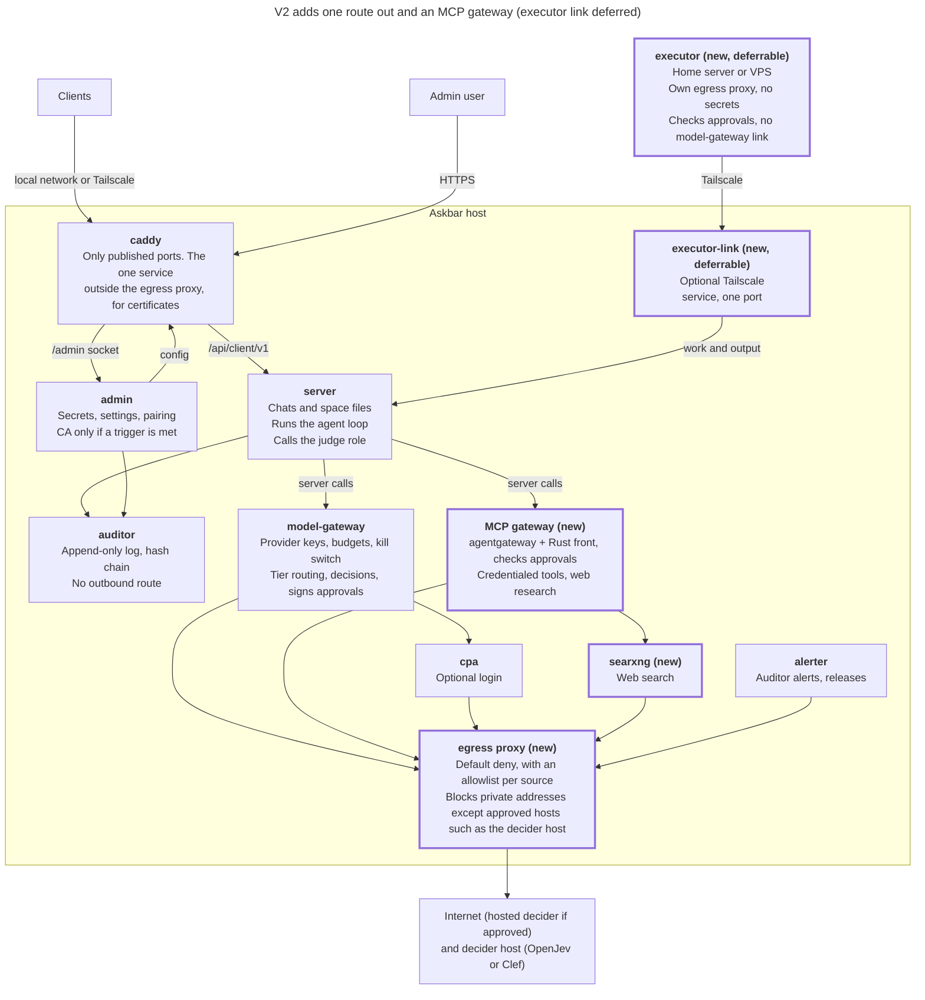

# model-gateway: Tiered Routing Design

Nov 10, 2026 · @Jake · revised Nov 18, 2026

## Summary

`model-gateway` sends each model call to the cheapest model that can handle it. Models sit in three cost tiers; a decider picks the tier for chat, and roles pick it for agents, research and the judge. The decider is a decision model (Jev, Clef, OpenJev or another System One model) that answers typed questions with calibrated probabilities and can also pre-check tool actions, check agent steps and filter research sources. The judge is the model role `judge.review`, not a component (see Judge and tool approvals). Agents use MCP tools; once the executor ships (deferrable), repeat requests can run an approved script instead of a fresh agent run.

Proposed as ADR 0056, it ships first after 1.0, before the egress proxy. Keys, budgets, the kill switch, the approved model list and audit-before-call stay in the gateway. Prompts reach an outside decision service only if the admin approves a hosted decider, under a zero-retention agreement and the privacy notice; a self-hosted decider (OpenJev, Clef) on a private host keeps them home.

## Decisions

| Area | Decision |
| --- | --- |
| **Models** |  |
| Tiers | `fast`, `standard`, `frontier`; admin confirms suggestions |
| Weights | 1 to 100, from price; admin override |
| Prices | Admin-set; budgets and caps in dollars |
| Effort | Auto, or the user's low, medium or high |
| Fallback | In-tier, before the first token; no local-to-cloud unless allowed |
| **Chat** |  |
| New chats | Auto after shadow mode; a chosen model skips routing |
| Sticky tier | Only moves up, except the budget step-down |
| User control | Client shows and changes the tier; no floor |
| Decider | The admin picks providers, tried in order: hosted (Jev, Clef, OpenRouter) or self-hosted (OpenJev, Clef) |
| Decider budget | `decider.timeout_ms` (800 ms) |
| Training | 300 labels tune question text and cut-offs, no retraining; live under 5% frontier-to-fast misses and below always-`standard` cost |
| Training share | Automatic or ask; deleted with the user |
| **Decision models** |  |
| Providers | One System One client, an adapter per provider; example order `cloudflare/clef-flash`, `typesafe/jev-1.14`, `openjev` |
| Outside decider | A hosted decider needs a recorded zero-retention agreement |
| Thresholds | From labeled sets; fail closed |
| **Agents, research and library** |  |
| MCP gateway | agentgateway behind a Rust front (approval check, audit, permissions, fetch rules); IBM ContextForge as fallback; decided after an evaluation (ADR 0057) |
| Executor | Deferrable, after agents with MCP tools |
| Step checks | Schema, decider, planner (exit code and tests once the executor ships) |
| Failed step | Retry on `standard`, then frontier fixer |
| Research filters | The decider drops passages, marks injected pages |
| Provider error | In-tier fallback; else interrupted, Resume |
| Tool calls | 8 per task by default (1 to 32) |
| Script library | Owner-approved scripts; drafts only in tests; deferred, after the executor |
| **Safety and cost** |  |
| Judge | `judge.review` reviews every tool action; signed approval required |
| Chat budget | Alert at 75%; step Auto down at 90% |
| Task budget | Strict cap; alerts at 75% and 90% |
| Subscriptions | 5-hour and weekly limits; alerts at 75% and 90% |

## Components

| Component | Role and changes |
| --- | --- |
| `model-gateway` | Routes by role, tier, weight; asks the decider; judge routing, signing. Adds dry-run and share-queue routes |
| `server` | Agent and research loops; judge calls; script catalog. Adds task tables; sends role, task, effort, share flag |
| `admin` | Owns `constants.rs` (every routing behaviour value) and pushes each service the values it uses, with configuration and keys; creates the signing key, pushes it and the decider keys; promotes and retires scripts. Adds a routing page for the settings in Configuration, decider thresholds and zero-retention record, decider comparison, `cpa` limits, spend views |
| Executor (deferrable) | Runs scripts and tests; no secrets; verifies approvals; no `model-gateway` link |
| MCP gateway | agentgateway (Linux Foundation AAIF, Rust, Apache-2.0) behind a Rust front, following the `cpa` pattern (ADR 0037); ContextForge (Python, Apache-2.0, needs PostgreSQL and Redis) is the fallback, chosen after an evaluation. agentgateway does MCP federation, transports, tool servers and their credentials, per-user per-tool rules; it listens only inside the private network. The front verifies the signed approval, writes the audit span before the call (fail closed), checks per-user tool permissions, enforces ADR 0019's fetch rules, serves `GET /status` and takes config pushes. Holds only tool credentials, no route to the server or admin APIs. Name, path prefix and networks in ADR 0057 |
| Private decider host | Serves a self-hosted decider (OpenJev or Clef; MLX, llama.cpp or vLLM); local network or Tailscale only |
| Desktop client | Auto in the picker; tier and effort controls; re-ask; shared marker; Resume |

## Models and tiers

**Tier suggestion.** From the price band for a paid model, or the parameter count Ollama reports for a local one. **Price.** The admin enters input and output prices per million tokens; a `cpa` subscription model gets an equivalent or 0.

**Weight.** 1 to 100 from blended price (60% input, 40% output); the tier's cheapest model gets 100:

```latex
w = 100 \cdot \frac{p_{\min} + 0.01}{p + 0.01}
```

The 0.01 stops a free model pushing paid ones to zero: $0 gets 100, $1 about 1. The admin page shows default and override side by side.

**Choosing.** The highest-weighted available model in the tier, ties to the lower price; a conversation keeps its model while it stays in the tier.

**Fallback.** If a model fails before its first token, try the next-weighted model in the tier, up to 3 tries.

- A model that keeps failing is skipped for 5 minutes; each try checks the cost cap.
- A local model's prompt never goes to a cloud provider unless the admin allows it.
- Once a reply is streaming, a failure ends the call.

**Effort.** The admin lists each model's levels; the gateway maps the level to the provider's field (`output_config.effort` for Claude, `reasoning_effort` for OpenAI-compatible APIs). A missing level falls back to the nearest and a model with no setting ignores it; both are recorded.

## Configuration

Pushed by the admin (prices are placeholders; the other numbers are the `constants.rs` defaults):

```yaml
routing:
  models:      # USD per million tokens, effort levels, tier, optional weight override
    ollama/local-mid: { input: 0,    output: 0,    effort: [],                  tier: standard }
    provider/small:   { input: 0.10, output: 0.40, effort: [low, medium, high], tier: fast }
    provider/mid:     { input: 1.00, output: 4.00, effort: [low, medium, high], tier: standard, weight: 40 }
    provider/large:   { input: 5.00, output: 20.0, effort: [low, medium, high], tier: frontier }
    cloudflare/clef-flash: { input: 0.05, output: 0.05, kind: decider }         # hosted on Workers AI; price is a placeholder
    typesafe/jev-1.14: { input: 0.042, output: 0, kind: decider }               # hosted; version pinned
    openjev:          { input: 0,    output: 0,    kind: decider, host: gpu-desktop }
  decider:
    providers: [cloudflare/clef-flash, typesafe/jev-1.14, openjev]   # tried in order within timeout_ms
    timeout_ms: 800
    chat:       { questions: [tier, effort, unsafe], unsafe_block: 0.90 }
    judge:      { mode: cascade, approve_hi: 0.97, approve_lo: 0.30, max_risk: 1 }
    step_check: { pass: 0.90 }
    research:   { relevance_min: 1, injection_flag: 0.50, max_ms: 1000 }
  roles:
    agent.worker: { tier: fast, retry_tier: standard }
    judge.review: { model: other-provider/large, backup: third-provider/large, effort: high }
  fallback: { max_tries: 3, skip_failing_s: 300, local_to_cloud: false }
  chat_auto: { default_tier: standard, user_ceiling: frontier, cutoffs: { standard: 0.35, frontier: 0.70 }, mode: shadow, training_share: automatic }
  task: { max_tool_calls: 8, cap_mode: strict }
  library: { mode: shadow, match_min: 0.85, fit_min: 0.80, candidates: 50, demote_below: 0.80, retire_after_failures: 3 }
```

A tier, pin or price naming an unapproved model rejects the push; thresholds are placeholders until labeled sets set them.

**Constants and config delivery.** `services/admin/src/constants.rs` is the admin's one home for behaviour values (compile-time `pub const`s with MIN_, MAX_ and DEFAULT_ ranges; visual values stay in `ui/tokens.css`). It holds every routing behaviour value as a default plus allowed range, and service code never holds a literal:

- Cut-offs, `decider.timeout_ms`, `max_tries`, `skip_failing_s`, weight range 1 to 100, price bands for tier suggestion, decider and library thresholds.
- Budget and subscription alert points (75 and 90; the 100% stop), subscription poll interval (5 minutes), task tool-call default and range (8; 1 to 32), research waits (8 s, 90 s) and summary size (800 tokens), approval expiry (60 s).
- A value a service also checks (bounds, defaults) is defined once in `askbar-proto` and re-exported by `constants.rs`, so admin and service can't disagree.
- Admin-editable settings (stored in the admin's database) override the default within the range; the admin validates before pushing.
- The admin pushes each service only the values it uses, inside that service's existing config push: `model-gateway` `PUT /config`, the server's snapshot; the MCP gateway's front through its own config push; later the executor (ADR 0028). The config version hash covers them, so a change re-pushes.
- A receiving service starts on the `askbar-proto` defaults, fails closed where this design says so until its first push, and rejects a pushed value outside the `askbar-proto` bounds. Hard floors set by ADRs (such as audit retention of at least 7 days) stay compiled into the enforcing service too.
- The auditor and alerter have no admin config link today and keep compiled values from `askbar-proto`; a push link for them would be a new link and needs an ADR.
- `/admin/constants.json` serves the same values publicly to the admin pages: no keys, no prompts, nothing secret.

## Roles

Every role is a model call, not a container: the server's loops make it; `model-gateway` picks the model, checks the cost cap and opens the audit span; tools run in the MCP gateway (and in the executor, if it ships; ADR 0019).

| Role | Default tier | Called by the server to |
| --- | --- | --- |
| `chat.auto` | Decider picks | Answer an Auto chat |
| `agent.planner` | `frontier` | Write the steps and final answer |
| `agent.worker` | `fast`, retry on `standard` | Run one step |
| `agent.fixer` | `frontier` | Revise steps after a failed retry |
| `research.researcher` | `fast` | Search, fetch, summarize |
| `research.writer` | `frontier` | Write and deliver the report |
| `judge.review` | `frontier` | Approve or refuse each tool action (in a cascade, only those the decider is unsure of) |
| `decider` | First of `decider.providers` | Answer typed questions (see Decision models) |
| `library.fill` | `fast` | Fill a matched script's inputs |
| `library.author` | `standard` | Draft a script, tests and description from a finished task |

**Pinning.** Any role can name one approved model instead of its tier, plus a backup pin. Pin the judge and its backup to providers other than the planner's and workers', so one provider's weakness can't fool both.

## Decision models

Decision models share the System One API: the gateway sends a `state` and typed questions; each answer carries calibrated probabilities per option, with no text to parse:

- `choice` picks one labelled option.
- `score` rates on an ordered scale of 2 to 10 levels.
- `noul` gives a yes/no probability.


**Providers.** The gateway has one System One client with a per-provider adapter for URL, auth and response quirks (Jev and OpenJev use `POST /v1/systemone`). The response's `confidence` field is not portable across providers, so the gateway uses only the probabilities.

| Provider | Runs | Speed | Cost | Limits |
| --- | --- | --- | --- | --- |
| `typesafe/jev-1.14` | TypeSafe's hosted API; version pinned | about 70 to 500 ms reported; no published p95 | about $0.042 per million input tokens reported; output free | US-hosted; zero retention only by agreement; early access |
| `openjev` | A private host, natively (not in Docker on a Mac) | 3 to 20 s on a 24 GB Mac mini M4 (MLX 4-bit); 24 GB NVIDIA card (GGUF Q4_K_M) to be measured | $0 per call | CC BY-NC 4.0 weights; text only in quantized builds; 16k-token prompts |
| `cloudflare/clef`, `cloudflare/clef-flash` | Cloudflare Workers AI, hosted: Clef is 27B, open weights, Qwen-based; Clef-flash is 9B, smaller and faster, same API, selector `clef-flash`; `POST https://api.cloudflare.com/client/v4/accounts/{ACCOUNT_ID}/ai/run/@cf/cloudflare/clef` | Not measured here; p95 per provider in shadow | Workers AI pricing; placeholder until the admin enters it | Zero retention only by agreement |
| Clef, Clef-flash (self-hosted) | A private host, as OpenJev | Clef about as slow as OpenJev (both 27B); Clef-flash roughly a third of the 27B time on a Mac mini (estimate, to be measured) | $0 per call | Weights licence: check licence |
| OpenRouter Decisions (aggregator) | `POST /api/alpha/decisions`; fronts Jev, Clef, Inception Mercury Decide and Liquid D1 | Not measured here | Check OpenRouter's pricing per model | Alpha API; prompts reach OpenRouter and the model's provider; zero retention only by agreement |

Use TypeSafe's own API: unaffiliated resellers forward the whole request body at up to ten times the price. On its own benchmark OpenJev scores 84.0% against hosted Jev's 85.4% and ties it on intent and routing (92.8%); neither covers Askbar's tiers or tool actions.

**Self-hosting.** OpenJev and Clef run on a private host. Clef-flash (9B) should take roughly a third of the 27B models' time on a Mac mini (estimate, to be measured), still seconds, so a self-hosted decider on a Mac fits shadow, judge pre-checks and local-only conversations, not live chat routing unless measured fast enough.

**Approval.** A decider is an approved model of kind `decider`: key in gateway memory, pushed by the admin; budgeted at the admin's price; audit span first; kill switch applies. A new pinned version re-runs the check.

**Uses.**

| Use | Questions |
| --- | --- |
| Chat tier | `tier`: score over three tier descriptions; `effort`: score low to high; `unsafe`: noul (blocks at `unsafe_block`; the score is `tier / 2`) |
| Judge pre-check | `approve`: noul; `reason`: choice of reason codes; `risk`: score from read-only to irreversible |
| Step check | `pass`: noul against the step's acceptance check |
| Research | `relevance`: score per passage (dropped below `relevance_min`); `injected`: noul per fetched page |
| Training | `tier` pre-labels examples; the owner reviews low-confidence ones |

Research filters run only when the decider answers within `research.max_ms`, so they are skipped and recorded on a slow self-hosted decider.

**What the decider sees.** Chat: the latest turn, a short summary of recent turns, current tier, context size and attachment types. Judge: the `judge.review` input. Research: fetched public pages. Never provider keys, memory, space contents outside the turn, or (for the judge) fetched pages and tool output. A local-model conversation uses a self-hosted decider or `default_tier`, unless `local_to_cloud` allows a hosted one.

**Calibration.** Third-party tests found hosted Jev overconfident, while one benchmark reports Clef's expected calibration error at 0.02 to 0.04 on four of five datasets; either way thresholds come from Askbar's labeled sets, per decider, never raw probabilities; the check reports per-use accuracy and suggests them.

**Failure.** Each use fails closed and records `decider_error`: chat takes `default_tier`; the judge path goes to `judge.review`, which refuses if it also fails; step checks go to the planner; research filters are skipped. A hosted decider outage sends every Auto chat to `default_tier`.

## Chat Auto

For each Auto message the gateway:

1. Runs the kill switch, user pause and approved-list checks.
2. The decider scores the latest user turn from 0 to 1 (the `tier` answer divided by 2) and the cut-offs map it to a tier; the same call, started alongside step 1, returns effort and `unsafe`.
3. Keeps the current tier and model if the new tier is lower.
4. Caps the tier at the user's ceiling.
5. Steps down one tier at the chat budget's step-down point (see Budgets).
6. Sets effort for the turn: the user's choice, else the decider's `effort` answer, else (if the decider failed) from turn length, context size and tool-loop depth.
7. Opens the audit span with the decision record, then calls the provider.

If the decider fails or misses `decider.timeout_ms`, the gateway uses `default_tier` and records why; the first token can arrive up to `timeout_ms` later.

**In the client.** Replies show their tier; the user can change the conversation's tier (within their ceiling) and effort (Auto, low, medium or high); both stick, and Auto stops moving a user-set tier. "Ask again on a stronger model" re-sends one tier up.

**Training.** The admin pushes labeled examples; nothing is retrained: labels tune question text and cut-offs.

1. **Label:** the owner writes or imports examples, tagging each with a tier; shared re-asks join a review queue.
2. **Check:** the gateway holds back 20%, runs it through the decider, reports accuracy, frontier questions sent to fast and cost against always-`standard`, and suggests cut-offs.
3. **Shadow:** the new questions and cut-offs record their picks while the current ones route; shadow can compare deciders side by side.
4. **Go live or roll back:** each push raises the configuration version; earlier sets stay in the admin.

A dry-run panel shows score, cut-offs and tier for any test prompt, per configured decider.

## Agents

&#91;embedded content: agent pipeline · planner, worker, retry, fixer\]

Agents ship with the MCP gateway, not the executor: their tools are MCP tools, limited to the user's permitted list.

- **Planner:** returns steps (inputs, one allowed MCP tool or none, acceptance check of type schema, decider or planner) and the final answer; the server validates the plan (tools exist and are permitted, within the tool-call limit) before any step runs.
- **Worker:** sees only its step and needed context, where most of the saving comes from.
- **Tool calls:** each needs a signed approval (see Judge and tool approvals) and counts toward the limit; tool output is untrusted data.
- **Checks:** deterministic where possible (JSON schema; exit code and tests once the executor ships), else the decider's `pass` answer if one is set; at or above `pass` the step is done, below it the planner reviews.
- **Retry:** a failed check reruns the step once on `standard`; a second failure goes to the fixer, and a second fixer round on one step ends the task.
- **Provider error:** fall back within the tier (see Models and tiers); if every try fails, the task stops as `interrupted` with Resume.
- **Stops** at the tool-call limit or cost cap; the planner then answers from finished work.

## Research reports

Ships with web research, under ADR 0019's controls.

1. **Split:** the writer turns the question into 2 to 4 research questions, or one if short.
2. **Research:** each researcher searches and fetches within the user's permissions and returns a summary of at most 800 tokens with URLs. If a decider is set and answers within `research.max_ms`, the decider first drops irrelevant passages and marks pages carrying instructions aimed at an AI, seen by the researcher.
3. **Wait:** after 2 summaries, wait up to 8 s for the rest; stop the stage at 90 s.
4. **Write:** the writer gets Source 1, Source 2…, notes agreement, conflicts and gaps, and streams a cited report.
5. **Degrade:** no summaries fails the request; one gives a report marked single-source.

The writer may call tools to deliver the report, each through the judge role; no memory writes for now.

## Script library

Repeat requests run a stored, owner-approved script, skipping the frontier planner, most of an agent task's cost; the pattern follows LATM, Agentic Plan Caching, Voyager and the `SKILL.md` format of Anthropic's Agent Skills. Deferred: ships after agents, with the executor, and only if the owner starts that phase. `model-gateway` makes the match decision and never runs code; the server keeps the catalog, drafts and success counts; the admin reviews, promotes and retires scripts; the executor runs scripts and tests. Credentialed workflow tools such as n8n come later, behind the MCP gateway, because the executor holds no secrets.

**An entry** is one folder:

| Part | Holds |
| --- | --- |
| `SCRIPT.md` | Name, matching description, when not to use, version |
| `inputs.json` | JSON schema for every input; fixed sets as enums |
| `run.sh` or `run.py` | Bash or Python in the executor's image |
| `tests/` | Sample inputs and outputs; run before promotion and after image changes |
| `manifest.yaml` | Allowed tools and egress hosts, writes or not, runtime versions, folder hash |

**Run a request:**

1. **Match:** the `decider` role asks a `choice` question over all entries' descriptions plus "none" (hosted Jev takes up to 255 options per question, self-hosted builds go in passes of 52; above that, a keyword prefilter in the server narrows the list to `candidates` entries) and a `noul` question "does this script do what was asked?"; in Auto chats both join the per-turn call.
2. **Fill:** `library.fill` fills the inputs and the server validates them against the schema; enum inputs can be decider `choice` questions.
3. **Approve:** `judge.review` reviews the inputs as for any tool action; the gateway signs the script's hash and inputs. A writing script runs its dry-run flag first, and the user confirms.
4. **Run:** the executor checks the approval and runs the pinned version; output and exit code go in the task.
5. **Answer:** a `fast` or `standard` model works on the output; the reply names the script and version.

No match, or one below `match_min` or `fit_min`, takes the normal agent path.

**Grow the library:**

1. After a task passes every check, the server asks the decider whether it could recur as fixed steps.
2. If so, `library.author` drafts the entry from the plan, step instructions and outputs, never fetched pages or tool output.
3. The executor runs the draft's tests in a sandbox with no network beyond the manifest's hosts; a failing draft is discarded.
4. The owner reviews the script, manifest and test results in the admin, then promotes, edits or rejects it; agents can't promote.
5. Promotion pins the hash and adds the entry to the catalog.

**Risks and mitigations**

| Risk | Mitigation |
| --- | --- |
| Poisoned script: an injection makes an agent write harmful reusable code | Owner promotion; drafts only in tests; author never sees fetched pages or tool output; hash pinning; judge reviews every run; no executor secrets |
| Wrong match | `match_min` and `fit_min` from labeled requests; "none" option; shadow mode; reply names the script; "Ask again" uses the agent path |
| Bad inputs | Schema validation; enums over free text; judge checks inputs; dry run before writes |
| Stale or broken scripts | Success rate per script; below `demote_below`, agent path; retire after `retire_after_failures` in a row; tests re-run on image change |
| Matching degrades with size | Above the option limit a keyword prefilter narrows to `candidates`, then the decider chooses; owner merges near-duplicates; descriptions say when not to use |
| Side effects or data leaving the host | Manifest tools and egress hosts, enforced by the egress proxy; writes need a signed approval and dry run |
| Cross-user exposure | One admin-approved library; per-user tool permissions; inputs and outputs stay in the user's space file |
| Results drift | Pinned hash and runtime versions; audit span records version, inputs hash and exit code |
| Executor escape | Executor hardening and egress proxy; no route to `model-gateway` |

**Go-live bar.** Shadow mode records matches without running them; go live when, on labeled requests, wrong-script matches stay under 2% and matched requests cost less than the agent path.

## Judge and tool approvals

The judge is the `judge.review` role, not a component. Reviewing every action removes any "gray area"; the signature means a compromised server can't run an action the judge never saw.

1. **Fixed rules:** the server applies ADR 0019's rules; failure refuses the action.
2. **Send:** the server calls `POST /decide` with use `judge`, the tool, its exact arguments and destination, the user's original request and the plan step, never fetched pages or tool output. The gateway runs steps 3 to 5 and returns the verdict and, on approval, the signed approval.
3. **Cascade** (only when `judge.mode: cascade`): the gateway asks the decider the `approve`, `reason` and `risk` questions on the same input.
   - `approve` at or above `approve_hi`, `reason` of `ok` and `risk` at most `max_risk`: approve, go to step 5.
   - `approve` at or below `approve_lo`: refuse with the decider's reason code.
   - Anything between, or a decider error: `judge.review` decides (step 4).
4. **Review:** `judge.review` on its pinned model returns approve or refuse with a reason code in a fixed format; anything else is a refusal.
5. **Sign:** on approval, the gateway signs and records a hash of the exact action, task, user, a one-time ID and a 60-second expiry.
6. **Verify:** the MCP gateway's front (and the executor, once built) checks the signature, hash, expiry and one-time ID before running; otherwise it refuses and records. The front also writes the audit span before the call and refuses if it can't.

**Rules**

- The signing key lives in the gateway's memory only, pushed by the admin like provider keys; tool containers hold the public key.
- Fail closed: if the judge is unavailable, over budget or out of format, the action is refused (in a cascade, once the decider has passed it on).
- Tool containers also enforce the fixed rules they can check (the MCP gateway's front knows its own search results and enforces the fetch rules, since agentgateway's rules can't read tool arguments; the egress proxy denies by default).

**Limits.** A compromised server can't run an unreviewed action, swap one after approval, or replay an approval, but can still ask the judge to approve a crafted action; the judge and the containers' rules are the barrier there.

- **Judge alone:** one frontier call per action; `standard` would cut cost at some loss of protection.
- **Decider cascade:** one decider call per action (about $0.00002 for 500 tokens at TypeSafe's reported Jev price); only uncertain actions reach the frontier judge. Thresholds from labeled Askbar tool actions set the gray band, and the decider becomes part of the barrier against a crafted action.

## Task state

Each task lives in the space's SQLite file, readable only by its members, backed up, migrated and deleted with the conversation (ADR 0009).

| Table | Holds |
| --- | --- |
| `tasks` | ID, conversation, kind, status (`running`, `done`, `stopped`, `interrupted`), tool calls used, cost so far, cap |
| `task_steps` | Step number, role, instructions, each attempt (`decision_id`, outcome), check result, output |

A step's row is written before it starts and updated when it ends. On start, the server marks any `running` task `interrupted`. Resume continues from the next unfinished step; a cut-off step reruns only on the user's confirmation, since its tool calls may have happened.

## Budgets and subscription limits

### Budgets

Budgets and caps are in dollars, from the admin's prices; routing never passes a budget, uses an unapproved model, explores at random or runs a call it can't audit; a routing error falls back to `default_tier` and is recorded.

- **Chat:** alert the admin at 75% of a user's monthly budget, step Auto down one tier at 90%, stop at 100%; a user-chosen tier isn't stepped down.
- **Tasks:** each task has a cost cap, checked before every step and every fallback try. A step that doesn't fit is refused with a `problem+json` 402 and the task stops with results saved. Tiers don't change mid-task; the user and admin get alerts at 75% and 90% of the task cap and monthly budget.
- **Decider:** decider calls count against the user's budget and task cap at the admin's price; over budget fails as in Decision models.

### Subscription limits

Claude and ChatGPT subscriptions behind `cpa` have 5-hour and weekly limits that only its management API, which the admin already calls (ADR 0042), reports. Every 5 minutes the admin lists the accounts (`GET /v0/management/auth-files`) and reads each one's usage through `POST /v0/management/api-call`, where `cpa` inserts the account's token so the admin never holds it. The admin calls only these two:

| Provider | Address | Returns |
| --- | --- | --- |
| Claude | `api.anthropic.com/api/oauth/usage` | 5-hour and 7-day percent used and reset times, plus 7-day per model family |
| ChatGPT (Codex) | `chatgpt.com/backend-api/wham/usage` | 5-hour and weekly percent used and reset times |

Neither is a documented API. A failed read shows "unknown", alerts once and never blocks calls.

- **Alerts:** at 75% and 90% of either window, once each, through the `alerter`.
- **Tokens left:** providers report percentages, so the admin divides the tokens Askbar sent to an account, per model, by the percent change between reads and shows tokens left per window and model; the estimate is low-confidence if the percentage moves without Askbar traffic.

```latex
\text{tokens per 1\%} = \frac{\text{tokens used since last read}}{\text{percent change}} \qquad \text{tokens left} = (100 - \text{percent used}) \times \text{tokens per 1\%}
```

- **Routing:** at 90% of either window the admin lowers that account's models to weight 1, at 100% marks them unavailable until the reset; each change is a recorded admin action, and this can be turned off.

## Audit and privacy

**Decision record.** Every span start gains routing metadata, never prompt text, so routing can be reviewed without opening sealed content. The gateway returns `decision_id` with each reply; the admin looks it up with its audit read token.

| Field | Example |
| --- | --- |
| `decision_id`, `config_version` | `rd_01J…`, 7 |
| `role`, `requested`, `model` | `chat.auto`, `auto`, `provider/mid` |
| `score`, `tier_raw`, `tier_final` | 0.31, `fast`, `standard` |
| `reasons` | `sticky` (one of `sticky`, `user_choice`, `budget_stepdown`, `decider_timeout`, `worker_retry`, `fallback`, `decider_error`, `judge_escalated`) |
| `decider`, `decider_scores` | `typesafe/jev-1.14`, `{ tier: 0.62, effort: 0.6, unsafe: 0.02 }` (probabilities only) |
| `effort`, `estimated_cost` | `low`, $0.0004 |
| `task_id` | Links a task's steps |
| `verdict`, `approval_id` | For `judge.review`: `approve` and the approval's one-time ID |

**Training share.** The one path where prompt text reaches the admin outside a sealed-content session:

- The server marks a re-asked question for sharing and sends it to the gateway's in-memory queue; the admin collects it over its own link, never called by the server.
- On `automatic`, the privacy notice says so and each shared message is marked in the client; on `ask`, the re-ask button asks first.
- Each share is an audit record (user, time, decision ID) without text; shared questions live in `admin.db`, deleted with the user.

**Outside decider.** Auto chats always send the turn to the decider. With a hosted decider, prompt text leaves the host for the decider's provider. The admin can approve it only after recording a zero-retention agreement (date shown on the admin page); the privacy notice names the hosted decider's provider and what it sees (see Decision models), and each call is an audit record (user, time, decision ID, use) without text. A self-hosted decider on a private host needs none of this. With no self-hosted decider and `local_to_cloud: false`, local-model conversations take `default_tier`.

## API

- `POST /chat` takes `role`, and optionally `tier`, `task_id`, `effort` and a share flag; a named `model` still wins. The first SSE event adds `decision_id` and `tier_final`.
- `POST /decide` takes a use (`judge`, `step_check`, `research`), a `task_id` and the state. The gateway builds the questions, picks the provider, checks the budget and opens the span, so the server never holds a decider key. `judge` returns a verdict and approval; `step_check` and `research` return decider answers.
- The client API accepts `model: "auto"` and a per-conversation tier and effort.
- New problem types: a task over its cap (402), and a missing or bad approval.

## Rollout

1. **Records only:** models, tiers, prices and decision records; no behavior change.
2. **Shadow:** the decider records its pick while users' models route; a hosted decider only once the zero-retention record exists.
3. **Auto by default:** for new chats, once the decider meets the go-live bar.
4. **Egress proxy** (ADR 0019), with a hosted decider's address on the allowlist if approved.
5. **MCP gateway:** an evaluation first (owner picks agentgateway or ContextForge), then the front, the search and fetch tools and per-user permissions.
6. **Research reports and the judge:** with web research; the cascade and research filters shadow until labeled sets set thresholds.
7. **Agents with MCP tools:** no executor; Jev step checks shadow the planner first.
8. **Admin web UI:** may start any time after the admin UI overhaul merges.
9. **Executor** (deferrable): code and file tools, exit code and test checks.
10. **Script library** (deferrable): drafts and owner review, then shadow matching, then runs once the go-live bar is met.

## ADR updates

Two new ADRs and sixteen amendments, checked against ADRs 0001 to 0056. Decision amendments need the owner's approval in the pull request (ADR 0001 rules 1 and 2); description amendments go in with the code.

| ADR | Type | Change |
| --- | --- | --- |
| **0056** (new) | Decision | Tiered model routing, decision models as providers, signed tool approvals and the script library: this design |
| **0057** (new) | Decision | The MCP gateway: agentgateway behind a Rust front (name, API path prefix and OpenAPI file, networks, hardening, approval check, audit before the call, per-user permissions, fetch rules), ContextForge as fallback, chosen after an evaluation; needed because ADR 0001 rule 3 requires an ADR for a new image or service |
| [0002](adr/0002-v1-scope-limits-and-ship-criteria.md) Scope | Decision | Routing ships after 1.0, outside the 100-hour estimate. The decider's budget is `timeout_ms` (800 ms); an Auto chat adds up to it to the 200 ms latency target |
| [0009](adr/0009-spaces-and-storage.md) Spaces | Decision | A space file also holds the task state of its conversations |
| [0010](adr/0010-auditor.md) Auditor | Decision | Span starts carry the decision record; each agent step is its own span, linked by `task_id`; judge verdicts, approvals, refusals and training shares are recorded |
| [0011](adr/0011-sealed-content-access.md) Sealed content | Decision | Two exceptions, each with notice and a record per use: shared training questions reach the admin outside a session, with a marker (a compromised admin can read them); with a hosted decider approved, chat turns, judge inputs and fetched pages reach its provider under a recorded zero-retention agreement |
| [0012](adr/0012-consent-notices-and-deletion.md) Consent | Decision | The notice states automatic sharing and, with a hosted decider on, what its provider sees; shared questions are deleted with the user, labeled or not |
| [0014](adr/0014-model-gateway-and-providers.md) Providers | Decision | The catalog gains weighted tiers, a default tier, role pins, deciders from several providers (hosted Jev, Clef or OpenRouter Decisions; self-hosted OpenJev or Clef), and each model's price and effort levels; budgets move to dollars; a conversation may store `auto`; in-tier automatic fallback replaces v1's no-fallback rule after 1.0. The rule that no prompt goes to an outside router becomes an admin choice: an approved decider may see prompts |
| [0016](adr/0016-risk-register.md) Risks | Register | Defend: unsigned or replayed tool actions are refused (test); the MCP front refuses a call whose audit span cannot be written, a tool the user lacks permission for, and a fetch outside ADR 0019's rules (tests); agentgateway is reachable only through the front (isolation test); decider thresholds come from Askbar's labeled sets and are re-checked on a version change (test). Accept: the admin reads shared questions; a misroute gives a weaker answer; a compromised gateway can shift tiers within budgets and sign any action; the undocumented usage addresses may break; a hosted decider's provider may retain or leak what it sees despite the agreement; a hosted decider outage sends every Auto chat to `default_tier`; a decider's calibration may drift between versions; a clear decider approval skips the LLM judge. Library: Defend: unpromoted or changed scripts don't run (test); a script reaches only its manifest's hosts (test). Accept: a promoted script the owner misread; a wrong match answers wrongly until the user re-asks; a compromised or malicious MCP tool server returns hostile output (refused by plan validation and the judge, not prevented); agentgateway is a young third-party project and its image falls outside the current scan job until extended |
| [0019](adr/0019-post-v1-order-and-tools.md) Post-v1 | Decision | Order: routing, the egress proxy, the MCP gateway, research and the judge, agents with MCP tools, the admin UI, then the executor and the script library (both deferrable); agents use MCP tools, the executor is deferred. The judge is the `judge.review` role, not a component: the server calls it for every tool action from a fixed input and format; `model-gateway` routes it to a model pinned to its own provider, optionally behind a decider cascade, and signs approvals tool containers check. The egress allowlist adds a hosted decider if approved. The writer is a role with tools and no memory writes. Per-role models become role pins |
| [0020](adr/0020-remote-executor-and-ca-triggers.md) Executor | Decision | The executor is deferred until after agents with MCP tools. When built, it gets the approval public key at pairing, verifies every action, has no `model-gateway` link and never calls the judge; it runs library scripts only with an approval covering the script's hash and inputs, and drafts only as tests |
| [0028](adr/0028-service-boundaries-and-config-delivery.md) Config delivery | Decision | Constants travel in each service's pushed config (`model-gateway` `PUT /config`, the server's snapshot, the MCP gateway's front; later the executor); bounds and defaults a service checks live in `askbar-proto`; the signing and decider keys are pushed and held in memory like provider keys |
| [0042](adr/0042-cpa.md) cpa | Description | The admin also lists accounts and reads usage through `api-call`, limited to the two usage addresses |
| [0054](adr/0054-model-gateway.md) Gateway | Description | When built: routes, signing key, prices, fallback, the decider client and `/decide`, the share queue, and a test that a marker prompt in the queue never reaches logs |
| [0039](adr/0039-server.md), [0040](adr/0040-admin.md), [0044](adr/0044-desktop-client.md) | Description | When built: the changes in the Components table; 0040 also records that the admin owns `constants.rs` and pushes values |

**0017 note** (Description; one commit with ADR 0057's code): the agentgateway image is third party, pinned by digest with a licence notice (Apache-2.0), and the Trivy `images` job may not scan pulled third-party images, a gap to close; new libraries and weights need a license reason in the pull request; OpenJev's weights are CC BY-NC 4.0, so commercial use needs a commercial licence first; check the Clef and Clef-flash weights licence too.

**Checked, no change:** 0006, 0022, 0023, 0032 (the MCP gateway and searxng follow its limits).

## Architecture and plan doc updates

Each change goes in its ADR's pull request.

### docs/architecture.md

- **Components, `model-gateway` row:** add "picks each call's model by role, tier and weight, asks the decider for the chat tier, routes the judge role's calls (running the decider cascade first when set), answers typed decisions for the server, and signs tool approvals".
- **Post-v1 names:** drop **judge** and add "The judge is a model role the server calls, not a component (ADR 0056)."
- **Other terms:** add or change:

| Name | Means |
| --- | --- |
| **space** (changed) | one SQLite file of a personal or shared space's conversations, history, memory, search and task state |
| **tier** | `fast`, `standard` or `frontier`; each holds approved models ranked by weight; code names a tier, never a provider |
| **weight** | a model's rank within its tier, 1 to 100; defaults from price; admin-overridable |
| **role** | the job of a model call, such as `chat.auto`, `agent.worker` or `judge.review`; sets a default tier, replaceable by a pin |
| **effort** | how much a model reasons: Auto, low, medium or high, mapped to each provider's setting; higher costs more |
| **Auto** | a chat setting where the decider picks the tier per message; it only rises within a conversation, and the user can change it |
| **task** | one agent or research run of steps, kept in the space file so it can resume |
| **judge** | the `judge.review` role, not a component; the server calls it for each tool action, alone or behind a decider cascade, and it approves or refuses before the action runs |
| **script library** | owner-approved scripts with an input schema, tests and a manifest; a matching request runs one in the executor instead of an agent |
| **draft** | a script an agent wrote from a finished task; runs only in tests until the owner promotes it |
| **decider** | a model answering typed questions with calibrated probabilities: hosted (TypeSafe Jev, Cloudflare Clef or Clef-flash, OpenRouter Decisions) or self-hosted (OpenJev, Clef) on a private host; picks the chat tier, pre-checks tool actions, checks agent steps, filters research sources |
| **approval** | the gateway's signature over one exact tool action, valid once for 60 seconds; tool containers refuse any action without one |
| **decision record** | routing metadata on a span start: role, model, tier, score, reasons, effort, cost estimate and, for the judge, its verdict |

### docs/plan-post-v1.md

- **Status line:** the order becomes tiered routing, the egress proxy, the MCP gateway, web research with reports and the judge, agents with MCP tools, the admin UI, then the executor and the script library, both deferrable (ADR 0019 as amended).
- **V2 sketch:** add "The judge and the report writer are model roles the server calls through `model-gateway`. Every tool action needs an approval the gateway signs; the MCP gateway's front checks it (the executor too, if built, and it never calls the gateway)."
- **Diagram:** replace it with this one, which drops the judge node and its two edges and names the new duties:



### Project doc: architecture-goals-and-features.md

- **Clients:** "The user chooses a model for each chat from the admin's approved list" gains "or Auto, the default for new chats, which shows its tier and lets the user change it and the effort".
- **Server:** add "`model-gateway` routes each call to a tier by role and to a model by weight, with budgets in dollars from admin-set prices. A decider (Jev, Clef or another decision model) picks the chat tier and can pre-check tool actions for the judge."
- **Admin:** add "Tracks subscription 5-hour and weekly limits and alerts before they run out."
- **Later:** add tiered routing first, noting it delivers "automatic provider fallback"; "Egress proxy, first after v1" becomes "Egress proxy, after tiered routing"; "shipped with a judge model that reviews gray areas" becomes "with a judge role that reviews every tool action, enforced by signed approvals".

## Sources

- Script library: [Voyager](https://arxiv.org/abs/2305.16291), [LATM](https://arxiv.org/abs/2305.17126), [Agentic Plan Caching](https://arxiv.org/abs/2506.14852), [SkillWeaver](https://arxiv.org/abs/2504.07079), [ASI](https://arxiv.org/abs/2504.06821), [skill-library survey](https://arxiv.org/abs/2607.10113), [Anthropic Agent Skills](https://platform.claude.com/docs/en/agents-and-tools/agent-skills/overview), [Hermes Agent](https://hermes-agent.nousresearch.com/docs), [n8n MCP workflow tool](https://glama.ai/mcp/servers/czlonkowski/n8n-mcp/tools/n8n_generate_workflow).
- [Askbar ADRs](adr/), read 2026-11-10.
- MCP gateway: [agentgateway MCP authorization](https://agentgateway.dev/docs/mcp/mcp-authz/), [agentgateway joins AAIF](https://agentgateway.dev/blog/2026-06-04-agentgateway-joins-aaif/), [IBM ContextForge](https://github.com/ibm/mcp-context-forge).
- [Claude effort parameter](https://platform.claude.com/docs/en/build-with-claude/effort) and [OpenAI reasoning guide](https://developers.openai.com/api/docs/guides/reasoning).
- [stream-micro PR 12](https://github.com/cropse/stream-micro/pull/12): usage via `cpa`'s `auth-files` and `api-call`.
- [cship usage limits](https://docs.rs/crate/cship/1.6.0/source/src/usage_limits.rs) and [codex-lb usage API](https://mintlify.com/Soju06/codex-lb/api/codex-usage).
- [OmniRoute Auto-Combo docs](https://cdn.jsdelivr.net/gh/diegosouzapw/OmniRoute@main/docs/routing/AUTO-COMBO.md).
- [OmniRoute fork release notes](https://github.com/LMPrado-DZ23/OmniRoute/releases).
- [LiteLLM auto routing benchmark](https://docs.litellm.ai/docs/proxy/auto_routing_benchmark.md).
- [mmrouter](https://pypi.org/project/mmrouter/).
- Jev API reference (jevtypesafeai.com, an unaffiliated reseller), read 2026-11-16.
- [OpenRouter: What is Jev](https://openrouter.ai/blog/insights/what-is-jev/), [eesel: Jev pricing](https://www.eesel.ai/blog/typesafe-jev-pricing), [NeuralTrust: Jev security review](https://neuraltrust.ai/blog/jev-typesafe-ai-security), [AIMLAPI Jev reference](https://docs.aimlapi.com/api-references/decision-models/typesafe/jev): price, versions, latency, data handling; secondary, so check against TypeSafe's docs.
- [Let's Data Science: lookalike Jev storefronts](https://letsdatascience.com/news/research-flags-lookalike-jev-storefronts-after-typesafe-laun-bf77c0d5).
- [OpenJev model card](https://huggingface.co/openjev/openjev), read 2026-11-16.
- [Cloudflare Workers AI: Clef](https://developers.cloudflare.com/workers-ai/models/clef) and [Flavio Copes: Clef](https://flaviocopes.com/clef/): Clef and Clef-flash, System One API, hosting.
- [OpenRouter Decisions API](https://openrouter.ai/docs/guides/features/decisions): the aggregator and the models it fronts.
- [Requesty: decision model benchmark](https://www.requesty.ai/blog/decision-model-benchmark-clef-sference-cloudflare-perplexity): Clef's calibration error; secondary.
- [oMLX benchmarks, M4](https://omlx.ai/benchmarks/s0m66e3b) and [M4 Pro](https://omlx.ai/benchmarks/o8xjwo8f): Qwen3.5-27B.
