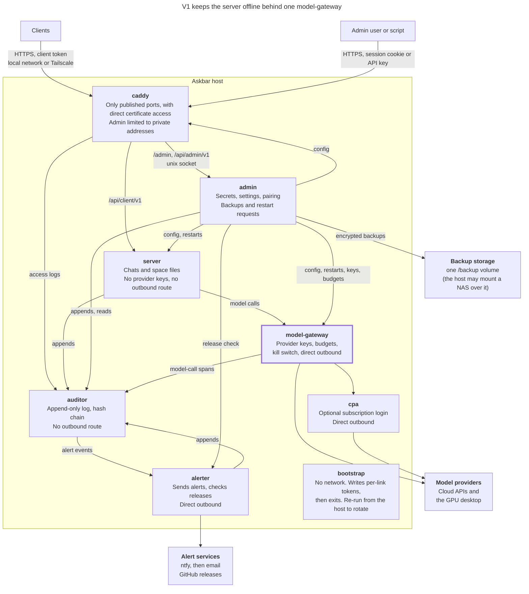

# Askbar guide

The details behind the [README](../README.md): how Askbar is put together, how to run, configure, upgrade and back up the server, the desktop app in full, the tests, and what is and is not verified.

This page describes Askbar v1 as built. The design and the reasons for it are in [architecture.md](architecture.md) and the [ADRs](adr/README.md). Where they disagree, build to the ADR.

## What Askbar does

- **Conversation only.** The model gets text in and returns text out. There are no tools, no shell, no file access, and the window is granted no filesystem or network permissions (`clients/desktop/src-tauri/capabilities/default.json`). Only the Rust side talks to your provider.
- **Any provider.** Anthropic, or anything that speaks the OpenAI `/chat/completions` protocol (OpenAI, OpenRouter, Ollama, LM Studio, vLLM, Groq, ...).
- **History** you can toggle (Ctrl+H), reopen and delete. Stored on your server, shared by every app you pair.
- **Copy in and out.** Paste anything into the bar. Copy a whole reply, a single code block, or the last reply (Ctrl+Shift+C).
- **Links ask first.** A reply is shown as formatted text, and nothing in it can run or load anything. A link in a reply opens only after the popup shows its whole address (the words on a link can say anything) and you press Open; Esc or Cancel closes it. Only web addresses (`http` and `https`) open. A picture in a reply is shown as a link, so no remote image is ever fetched.
- **Replies run on the server.** Close the window or lose the connection and the reply keeps going; reopen the app and it is there.
- **Keys stay off the desktop.** The desktop app is a thin client; provider API keys never reach it, or the server.

## How it fits together

Askbar is a desktop client and a small set of containers:

- **Desktop client** (Tauri): the popup. It pairs with one server and holds only its address, a hotkey and a client token (in the OS keychain).
- **`askbar-server`**: the client API. It stores conversations and asks `model-gateway` for each reply; it holds no provider key and has no route to the internet. It has no web UI and no login.
- **`askbar-model-gateway`**: holds the provider keys in memory and calls the providers ([ADR 0054](adr/0054-model-gateway.md)).
- **`askbar-auditor`**: keeps the audit store and its hash chain; it has no route out ([The auditor](#the-auditor)).
- **`askbar-alerter`**: delivers alerts and checks for new releases ([The alerter](#the-alerter)).
- **`caddy`** and **`cpa`**: the HTTPS front end, and CLIProxyAPI for a Claude or ChatGPT subscription.
- **`askbar-admin`**: the admin site. It owns all configuration (providers, system prompt, display defaults, pairing codes, clients, network and HTTPS settings, limits and the kill switch) and pushes it to the server over a private server API. Its **Audit** page shows what the auditor recorded about every reply.

There is no standalone mode: the client always talks to a server.



The same picture is in [architecture.md](architecture.md#picture), with what each container holds, what a failure does and every link's network in the tables after it.

How the pieces fit, and why, is in [architecture.md](architecture.md); the HTTP APIs are described in [openapi/](openapi/) (client, server, admin); contributing is in [CONTRIBUTING.md](../CONTRIBUTING.md) and security in [SECURITY.md](../SECURITY.md).

## The desktop app

Prerequisites: [Rust](https://rustup.rs), Node 18+, and your platform's WebView.

| Platform | Needs |
|---|---|
| Linux | `build-essential libwebkit2gtk-4.1-dev libayatana-appindicator3-dev librsvg2-dev libxdo-dev libssl-dev` |
| macOS | Xcode command line tools |
| Windows | Visual Studio Build Tools (C++), WebView2 (preinstalled on Windows 11) |

```sh
cd clients/desktop
npm install
npm run dev        # run it
npm run build      # installers land in clients/desktop/target/release/bundle/
```

The app is its own Cargo workspace (`clients/desktop/`), so building the server needs none of these libraries.

Until the app is paired it shows how to pair. Tray icon > **Pair with server...**, paste the pairing key from the admin site (Clients), or make one in an app you already paired (tray icon > **Pair another app...**). A key works once and expires after 10 minutes; the app exchanges it for a per-client token stored in the OS keychain, not in a file. Revoke a client in the admin site and the app shows "token rejected". If the server can't be reached the app says "server offline"; there is no offline mode.

The app reads the token from the keychain once per launch. On macOS a build from `npm run dev` is unsigned, so after each rebuild macOS asks once for the keychain password before that build can read the token; **Always Allow** covers that build until the next rebuild.

`client.yaml` (`~/.config/askbar/` on Linux, `~/Library/Application Support/askbar/` on macOS, `%APPDATA%\askbar\` on Windows; `ASKBAR_CLIENT_CONFIG` points at a different file, which is how you run a second profile) holds only:

```yaml
server_url: https://askbar.example.com
hotkey: "Ctrl+Shift+Space"
allow_insecure: false          # a client refuses http:// unless the server is on this machine
ui:                            # optional; anything left out follows the server's defaults
  theme: dark
  width: 640
```

The model you chose for new chats and your other preferences are stored on the server per user. Tray icon > **Reload config** applies `hotkey` and `ui` changes.

## Using it

| Key | Action |
|---|---|
| your hotkey | show / hide |
| Enter / Shift+Enter | send / new line |
| Esc | stop a reply that is streaming; otherwise hide |
| Ctrl+H | history panel |
| Ctrl+N | new conversation |
| Ctrl+Shift+C | copy the last reply |

**What the app tells you.** Above the input box a line says "AI can make mistakes. Check important information." After you pair, and again whenever it changes, the app shows a **privacy notice**: what Askbar records, who can open it, and how many days audit records are kept, with a **Got it** button. The app does not send anything back: your administrator made you a user, which assumes your consent, so it only remembers which version of the notice it last showed. The administrator can change the wording of either, or turn either off, in **Settings > What people are told**; changing the wording or the audit retention shows the notice again. Each deployer is responsible for consent, notice and the law where they are (for minors, employees and other countries): the default wording is a start, not legal advice.

The footer shows the model for this chat, the five key hints and a **Source** link to the project's source code (Askbar is free software under the AGPL-3.0-or-later). The link asks first, like every link: the bar shows its whole address, and nothing opens until you press Open.

In the history panel, click a conversation to reopen it. Delete needs two clicks ("Delete" then "Delete?"), and removes the conversation and its messages. Ctrl is used on macOS too, since Cmd+H and Cmd+N belong to the system.

## Replies run on the server

A reply is produced by the server, not by the window. The question is saved first and the server writes the answer as its own task, so closing the app, sleeping the laptop or switching networks does not stop it. When the window comes back it asks for the rest of the reply and picks up where it left off, without repeating or dropping text; a second client paired to the same server can open the conversation and watch the same reply.

- **Waiting messages.** You can send another message while a reply is running. Up to **5** messages can wait in one conversation, and they run one after another; a sixth is refused ("Five messages are already waiting...") and your text is kept. A waiting message can be removed from the window.
- **Stop** (Esc or the Stop button) tells the server to stop the reply; the text so far is kept.
- **Time limit.** A reply that runs longer than **300 seconds** is stopped; the text that arrived stays, the window says "Stopped after 5 minutes" and offers **Try again**. The limit is the **Generation timeout** in the admin site's Settings (30 to 3600 seconds).
- **Restarts.** If the server is restarted mid-reply, the reply ends as interrupted and keeps the text it had.
- **Refusals.** When the administrator has switched replies off (the kill switch in Settings), a daily or monthly token limit is used up, or the audit key has not been made yet, your account is paused, or the model you chose is not approved, the window says so in words and keeps what you typed. A busy server is tried once more by itself.
- **Failed questions are not resent.** A question that got no reply stays in the conversation but is not sent to the model with your next one, so a question the provider refuses can't stick the conversation. To retry it, send it again (or **Try again** after a timeout).
- If another provider than the one you chose answered (the server fell back), the reply says "Answered by ...".

## Hotkeys by platform

`Super+A` is accepted (`hotkey: "Super+A"`) and works on X11, but Windows reserves it for Quick Settings and GNOME for the app grid, so the default is `Ctrl+Shift+Space`. If a hotkey can't be registered, the window opens with the reason.

**Wayland** does not allow ordinary apps to register global hotkeys. Bind a shortcut in your desktop's keyboard settings to the command `askbar`. Running it while Askbar is already running toggles the window instead of starting a second copy. This also works on any platform.

## Server

Needs Docker with Compose.

```sh
cp .env.example .env
docker compose up -d --build
```

To stop it, or before rebuilding after an update, use `docker compose --profile dev down --remove-orphans`. With `--profile dev`, the mock LLM is removed as well; without it, a dev container left behind can point at a network that no longer exists.

That starts these containers, with `bootstrap` (no network, exits when it has made the tokens) before them. The mock LLM of the `dev` profile is not listed:

| Container | Runs as | Network | Published |
|---|---|---|---|
| `askbar-caddy` | root (group 10001) | `edge`, `client-api`, `audit-caddy` | **443, 80** |
| `askbar-server` | uid 10002 | `client-api`, `server-api`, `gateway-server`, `audit-server` | nothing |
| `askbar-admin` | uid 10001 | `server-api`, `cpa-admin`, `audit-admin`, `gateway-admin`, `alerter-admin` | nothing (a unix socket) |
| `askbar-auditor` | uid 10003 | `audit-admin`, `audit-alerter`, `audit-caddy`, `audit-model-gateway`, `audit-server` only | nothing |
| `askbar-model-gateway` | uid 10004 | `gateway-server`, `gateway-admin`, `audit-model-gateway`, `cpa-gateway`, `outbound` | nothing |
| `askbar-alerter` | uid 10005 | `audit-alerter`, `alerter-admin`, `alerter-outbound` | nothing |
| `askbar-cpa` | root (group 10001) | `cpa-admin`, `cpa-gateway`, `outbound` | nothing |

`server-api` is an `internal` network shared by the admin and the server's server API. No address is fixed: the server has the alias `server-api-host` on that network only, listens on the address it resolves to (port 8082), and the admin calls `http://server-api-host:8082`. So the server API answers on `server-api` and nowhere else. Caddy is the only thing the outside world can reach.

### Docker networks

Askbar gives each link between two services its own network, so a service reaches only the services it has to ([architecture.md](architecture.md#links)). The stack has fifteen networks (`edge`, `client-api`, `server-api`, `cpa-admin`, `cpa-gateway`, `audit-admin`, `audit-alerter`, `audit-caddy`, `audit-model-gateway`, `audit-server`, `alerter-admin`, `alerter-outbound`, `gateway-admin`, `gateway-server` and `outbound`). Each network takes a subnet from Docker's address pools, and with Docker's default settings a host has about 30 to share between all its Compose projects. When they run out, `docker compose up` fails with:

```text
could not find an available, non-overlapping IPv4 address pool among the defaults to assign to the network
```

The fix is to give Docker smaller subnets, so the same address range holds many more networks. On Linux, add this to `/etc/docker/daemon.json` (create the file if it does not exist) and restart Docker with `sudo systemctl restart docker`. With Docker Desktop, paste it under **Settings > Docker Engine** and press **Apply & restart**:

```json
{
  "default-address-pools": [
    { "base": "172.16.0.0/12", "size": 24 }
  ]
}
```

That gives 4,096 networks of 254 addresses each, plenty for Askbar and any other projects on the host. Pick a `base` your home network or VPN does not use. If yours uses part of `172.16.0.0/12`, use a range such as `10.200.0.0/16` (256 networks) instead. Networks that already exist keep their subnets. Run `docker compose down` and then `docker compose up -d` to recreate Askbar's from the new pools.

New Askbar networks never pin a subnet; Docker assigns them from these pools.

Every container has a read-only root filesystem, no Linux capabilities (Caddy keeps only the one to bind 80 and 443), no privilege gain, and limits on processes and memory; it writes only to its own volumes and a private `/tmp` ([ADR 0032](adr/0032-container-hardening.md)). Caddy, though root, reads the admin's certificate key and Cloudflare token (mode 640) and makes its admin socket through group 10001.

- The **server** serves the client API, which accepts only `Authorization: Bearer <client token>`. Chat replies stream as Server-Sent Events (`meta`, `provider`, `delta`, `done`, `error`) and can be resumed after a dropped connection. Client tokens are random, shown once, and stored as SHA-256 hashes. See [docs/wire-contract.md](wire-contract.md).
- The **admin** listens on a unix socket only. Caddy proxies the site (`<hostname>/admin`) and its API (`<hostname>/api/admin/v1`) to it, and the admin owns `admin.db`. Each section of the site is its own page with its own address (`/admin/providers/`, `/admin/services/`, `/admin/clients/`, `/admin/audit/`, `/admin/backup/`, `/admin/network/`, `/admin/security/`, `/admin/settings/`; `/admin` opens the first), so a page can be bookmarked and Back works. Every change is made in `admin.db` and pushed to the server as one snapshot; if the server is down the change is refused ("The server is offline. Nothing was changed.") rather than half applied. With the server stopped the admin still loads and shows an offline banner.
- The **server API** requires a bearer token. `bootstrap` makes it ([Tokens between services](#tokens-between-services)): the admin reads it from its own volume, `admin-token`, and the server holds only its SHA-256 (`accept/admin-server.sha256` in `server-token`, read per request, compared in constant time, and the API refuses everything when the file is missing).
- **Provider API keys** are kept by the admin, encrypted at rest (ChaCha20-Poly1305) with the admin's own key (`admin-secrets`), and pushed to `model-gateway`, which holds them in memory only ([model-gateway](#model-gateway)). The server holds none. No endpoint returns one. The Cloudflare token is encrypted in `admin.db` with the admin's own key (`admin-secrets`), separate from the server's, and written to a file only Caddy reads.

### First run

From the first start Caddy serves HTTPS on port 443 of every address of the host, with a certificate the admin makes for this install (port 80 redirects). Open **`https://localhost/admin`** on the machine that runs Docker, or `https://<its address>/admin` from another machine, and accept the browser's warning. Until you set a host name, the admin site answers only private addresses (loopback, 10/8, 172.16/12, 192.168/16, Tailscale's 100.64/10 and the IPv6 equivalents) unless the allowlist names others. Caddy checks the connection's real source; a router or proxy that rewrites sources can make public traffic look private. A pairing key made now points at the address you opened the admin with and carries the certificate's fingerprint, so the app trusts exactly this certificate for this server (set `ASKBAR_PUBLIC_URL` in `.env` to choose another address). Once a host name and a real certificate are set (step 5) use `https://<hostname>/admin`.

1. Open the admin (above).
2. Sign in as **`admin`** with the password **`admin`**. Every page but the password change refuses (403 `password_change_required`) until you choose your own: at least 10 characters, not `admin`. Anyone on a private address can use the published login until you do, so do it as soon as the stack is up.
   - **Locked out?** On the host, `docker compose exec admin askbar-admin reset` puts the published login back (you must change it again at the next sign-in) and records the reset on the Services tab; then `docker compose restart admin` to sign out every session. If the admin is not running, use `docker compose run --rm admin reset` instead.
3. **Audit passphrase.** Setup asks for one: at least 20 characters. See *The Audit page* below; write it down.
4. **Backup passphrase.** Setup asks for a second one, at least 20 characters and different from the audit passphrase. The admin makes an age key pair from it, keeps the public key and the private key protected by the passphrase, and forgets the passphrase: **it cannot be recovered**, and without it no backup can be opened, so keep it somewhere safe that is not this server. The Backup page shows the key's fingerprint and can rotate it (it needs a sign-in within the last 10 minutes). An install from before this is asked on its next visit.
5. **Providers** > add one (Anthropic or OpenAI-compatible: after you enter the address and key, **Model** becomes a dropdown of what the provider offers) and press **Test**: it streams a short fixed message and shows pass or fail and the time to the first text; **Details** shows the request's path, the status and the timings, never the reply or a provider's error text. For a Claude or ChatGPT subscription use **Services** instead: *Connect Claude* / *Connect ChatGPT* (see *CLIProxyAPI*); no terminal is needed.
6. **Network** > hostname, how to prove it is yours (the Cloudflare token, or HTTP-01) and, if you want it, the allowlist (see below).
7. **Clients** > add a user, then generate a pairing key for them.

No secret ever goes in `.env`, so nothing sensitive can be committed by accident.

### HTTPS with your own hostname

Certificates come from Let's Encrypt. You choose how Caddy proves the hostname is yours (**Network** > the challenge):

- **DNS challenge through Cloudflare** (the default): works for a hostname that points at a private address. In Cloudflare, add an `A` record for your hostname (for a private server, its LAN address), and create an API token with **Zone:DNS:Edit** and **Zone:Zone:Read**.
- **HTTP-01**: works with any DNS provider and needs no token, but **port 80 on this machine must be reachable from the internet** (forward it on your router; Caddy answers Let's Encrypt there, and redirects everything else on port 80 to HTTPS) and the hostname must point at your public address. It cannot work for a name that only resolves inside your network (`.local`, `.lan`, `.internal` and the like are refused).

1. Admin site > **Network**: tick HTTPS, enter the hostname and choose the challenge (with DNS, enter the Cloudflare token). Leave **staging** on for the first try, then turn it off for a trusted certificate; Let's Encrypt limits failed attempts.
2. The apps reach the server at `https://<hostname>` and the admin site is at `https://<hostname>/admin`. One name, one certificate; every other path is a 404.

The admin allowlist is **off by default**: anyone who can reach `https://<hostname>/admin` can try to log in (login is rate limited). Tick **Only let these addresses open the admin site over HTTPS** and list addresses or CIDRs (for example `192.168.1.0/24`) to make Caddy drop every other address before it reaches the admin. If you reach the admin from the same machine through Docker, the connection can appear to come from the Docker gateway (for example `172.x`), so include that range.

### The Audit page

The stack records a trace of every reply (the auditor keeps it; the admin reads it): when, for whom, through which provider, how long each step took, how many tokens it used, which providers were tried and how it ended. The admin site's **Audit** page (`/admin/audit/`) shows it as an overview, a list of requests, a timeline for each one, routing (which providers answered and how often they failed), and an access history. The address follows the view, so one request can be bookmarked or sent: `/admin/audit/?view=trace&id=<trace id>`.

The **content** of messages (prompts, replies, provider errors) is *sealed*: the server encrypts it with a public key that is made from your audit passphrase (Argon2id to an X25519 key) and never holds the passphrase or the private key. It cannot read what it recorded. To read content, open a request on the Audit page, go to its **Content** view and type the passphrase under **Sealed content**: that **unseals** for a while (you must have signed in within the last ten minutes), and View then shows each item without asking again. The admin derives the keys in memory and never stores them. A banner on every page shows how long it will stay open and has a **Seal** button. It seals itself after **15 minutes without use or an hour in all** (change both in Settings, up to 12 hours each), when you press Seal, when you sign out, or when the admin restarts. A passphrase for an older key, typed while it is open, adds that key. Each unseal, each item viewed, each Seal and each timeout is recorded in the auditor and in the access history (the request, the key and the time, never the content), and an unseal and any change of the timeouts also show as an alert banner for a day, so an unseal you did not do stands out. An unseal is refused if the auditor cannot take its record. An admin API key cannot unseal.

- The passphrase is chosen during setup and **cannot be recovered**. If you lose it, the sealed content recorded with it can never be opened; the rest of the trace (times, tokens, routes, outcomes) stays readable.
- **Settings > Rotate the audit key** makes a new key from a new passphrase. Content recorded earlier stays sealed with the old key and still needs the *old* passphrase.
- Records older than **Keep audit records for (days)** (default 30, at least 7) are deleted once a day. Nothing younger than 7 days can be deleted.
- Until a key exists the server refuses to start replies (`503`), rather than record them unsealed.

The trace lives in the auditor's `audit.db` (`auditor-data` volume). The server and the gateway record their parts of it, and the admin reads it from the auditor with its own read token and applies its prices, so a corrected price changes every figure. If the admin cannot reach the auditor, the Audit page says so and shows nothing until it can.

### CLIProxyAPI

Lets a Claude or ChatGPT subscription act as an OpenAI-compatible provider. It starts with the stack and idles until you connect an account. Everything is done in the admin site, **Services** tab:

1. **Connect Claude** (or **Connect ChatGPT**). The admin asks CLIProxyAPI for a login address.
2. Open the address and approve. The browser then lands on an address starting `http://localhost` that will not load if the admin is on another machine. Copy that whole address from the address bar and paste it into the box. **Finish**.
3. A provider named **CPA** appears on the Providers page, already holding the key the admin made for CLIProxyAPI. Choose its model from the dropdown. Its name, address and key are fixed.

The admin makes CLIProxyAPI's config and API key itself (nobody copies a key anywhere). CLIProxyAPI joins `cpa-gateway` (`model-gateway` reaches it there), `cpa-admin` (the admin runs logins there) and `outbound` (its route out, the same network `model-gateway` uses; it is not on `edge`); its API is never published. See [deploy/cpa/README.md](../deploy/cpa/README.md).

### Configuration reference

**`.env`** (read by Compose; nothing secret):

| Variable | Default | Meaning |
|---|---|---|
| `ASKBAR_PUBLIC_URL` | empty | address put in pairing keys until HTTPS is configured; with HTTPS on it is `https://<hostname>` |
| `DATA_DIR` | `./data` | where the server's `control.db` and `spaces/` live on the host; must be writable by **uid 10002** |

**Upgrading from 0.5 to 0.6 (spaces): wipe the server's data and pair again.** Conversations now live in one file per space ([ADR 0009](adr/0009-spaces-and-storage.md)); before 1.0 nothing is migrated ([ADR 0018](adr/0018-releases-and-migrations.md)), so the server's conversations, paired apps and stored provider keys go. The admin's settings, users and providers stay, and the admin pushes them again; it keeps the key only for its own CLIProxyAPI provider, and sends that one again by itself.

1. `docker compose --profile dev down` (not `-v`: no volume is removed or renamed).
2. Empty the server's data directory: `rm -rf ./data/*` (or your `DATA_DIR`). The server no longer reads `askbar.db`; if one is left it says so in its log and leaves it alone.
3. `docker compose --profile dev up -d --build`.
4. In the admin site, **Providers** shows "key missing" for each provider whose key went with the data: edit it and enter the key again.
5. Update the Askbar app to 0.6.0 (a 0.5 app is told it is too old), create a pairing key for each user in the admin site, and pair each app again.

**Upgrading from 0.4 to 0.5** (stop the stack, pull, rebuild, update the app):

1. Back up first: `data/`, and the `askbar-secrets`, `admin-data`, `admin-secrets` and `audit-data` volumes (see *Backup and recovery*).
2. `docker compose down` (not `-v`), `git pull`, `docker compose up -d --build`. The databases migrate themselves on the first start (the `devices` table becomes `clients`; paired apps and their tokens are kept). <!-- names-ok: the old names are the point of this note -->
3. What moved: the admin is at `https://<hostname>/admin` (the `admin.<hostname>` name and its DNS record are no longer used; before HTTPS was set up 0.5 used `http://127.0.0.1:8081/admin/` on the Docker host; that page is gone, see *First run*). The old token volume `askbar-mgmt` and network `mgmt` are replaced by `server-token` and `server-api`; the admin makes a new server token and writes its hash there on first start, so the old volume can be removed. Data volumes keep their names. CLIProxyAPI now starts with the stack (it idles until you log in). <!-- names-ok: the old names are the point of this note --> If you ran an earlier build of this branch, remove its leftover network first: `docker network rm askbar_setup` (the first-run page now uses `askbar_admin-setup`).
4. Update the Askbar app to 0.5.0. Paired apps keep their tokens, so nothing needs pairing again; an older app says it is too old for the server.
5. If you set any of these in your own compose file, rename them: `ASKBAR_API_ADDR` to `ASKBAR_CLIENT_API_ADDR`, `ASKBAR_MGMT_ADDR` to `ASKBAR_SERVER_API_ADDR`, `ASKBAR_SERVER_MGMT_URL` to `ASKBAR_SERVER_API_URL`, `ASKBAR_MGMT_DIR` to `ASKBAR_SERVER_TOKEN_DIR`, `ASKBAR_MGMT_TOKEN_HASH_FILE` to `ASKBAR_SERVER_TOKEN_HASH_FILE`. <!-- names-ok: the old names are the point of this note -->
6. If anything of yours calls the HTTP APIs: the apps' API is now `/api/client/v1` (`/pair` is `/pairings`, `/whoami` is `/me`), the admin's is `/api/admin/v1`, and every error is a [problem](wire-contract.md#errors) with a stable `error` code.

**Upgrading from 0.2:** the server image now runs as uid 10002 (it was 10001; 10001 is the admin). `chown -R 10002 $DATA_DIR` before starting. The old single-server layout (admin site on :8081, `ASKBAR_UID`/`ASKBAR_GID`, `ASKBAR_API_PORT`, the `tls` profile and Caddy on 8443/9443) is gone, and the first start migrates the database (providers, settings and pairing codes now live in the admin; re-enter them there).

**Set in the admin site** instead of in files: admin password, hostname, certificate challenge, Cloudflare token, allowlist, the Let's Encrypt staging switch, the system prompt, display defaults and per-user defaults.

**Compose profiles:** the services (server, `model-gateway`, auditor, alerter, admin, Caddy, CLIProxyAPI) are always on; `bootstrap` runs once at each start. `dev` adds a mock LLM (`tests/e2e/mock_llm.py`).

### Tokens between services

Each link between two services has its own token ([ADR 0004](adr/0004-bootstrap-and-per-link-tokens.md)). A one-shot container, `bootstrap` ([ADR 0049](adr/0049-bootstrap.md)), makes them: it has no network, runs as root with one capability (`CHOWN`), mounts only the credential volumes, and exits. The services start after it has finished. Every link and the prefix of its tokens is in `services/bootstrap/src/links.rs`, which a test checks against the Links table in [architecture.md](architecture.md#links); `docker compose run --rm bootstrap list` prints them.

- **Where they are.** One volume per service, `<service>-token`: `server-token` (the server's, as before), `admin-token`, `auditor-token`, `model-gateway-token` and `alerter-token`. Inside, `call/<link>.token` is a token the service sends and `accept/<link>.sha256` is the hash of a token it checks. A token is mode 400 and its caller's; a hash is mode 444 and its receiver's. Each service mounts only its own volume, read-only.
- **Install.** Nothing to do: `docker compose up -d` runs `bootstrap` first. A second run changes nothing.
- **Upgrade from a build before `bootstrap`.** `docker compose up -d --build`. `bootstrap` makes a new `admin-server` token; the admin reads it and deletes its old `server.token` on start, and the server reads the new hash. Nothing for you to do, and no one is signed out or re-paired. The old `token.sha256` in `server-token` is no longer read; the server refuses to start without the new file and says to run `docker compose up -d`.
- **Rotate** from the Docker host, then restart what it names from the admin site's **Services** page:

  ```sh
  docker compose run --rm bootstrap list                   # the link names
  docker compose run --rm bootstrap rotate admin-server    # one link
  docker compose run --rm bootstrap rotate --service admin # every link of one service, after a suspected compromise
  docker compose run --rm bootstrap rotate                 # every link
  ```

  The old token stops working when the receiver is restarted. Until then, and until the caller is restarted, calls between the two fail.
- **A rejected token.** If the server stops accepting a token that worked (its hash file was replaced, say, or only one side was rotated), the admin site shows a banner with the commands and stops showing "server offline": the server is there, it just refuses this admin. Run `docker compose run --rm bootstrap rotate admin-server`, then `docker compose restart server admin`. The admin cannot restart the server itself, because the server refuses its calls. It logs one line naming the link, never the token, and the banner goes away when the server accepts the token again. The server logs one line when five invalid tokens arrive on its server API within ten minutes, naming the link (`admin-server`) and the count, then stays quiet until the count has dropped below five again ([ADR 0024](adr/0024-rejected-token-alert.md)); the alerter delivers them as `rejected_token` alerts ([The alerter](#the-alerter)).
- **Backup.** The credential volumes need none: if they are lost, `bootstrap` makes them again and you restart the services.

### The auditor

The audit store has its own container, `askbar-auditor` ([ADR 0051](adr/0051-auditor.md), [ADR 0010](adr/0010-auditor.md)). It holds `audit.db` on its own volume, `auditor-data`, runs as uid 10003 with no capabilities, and has no route out: it joins only `audit-*` networks, each shared with one caller. There are four: `audit-admin` (the admin), `audit-server` (the server), `audit-model-gateway` (`model-gateway`) and `audit-caddy` (Caddy's access lines). Its API is `/api/audit/v1` ([docs/openapi/audit.v1.yaml](openapi/audit.v1.yaml)) and it is never public.

**The server and `model-gateway` send it their records** (the gateway opens each reply's turn and try spans and waits for the acknowledgment before it calls a provider; the server adds the gates it passed, its sealed request and reply, and how the reply ended). The server's own `audit.db` is gone: `audit-data` stays on disk untouched and the auditor starts with its own empty `auditor-data`, so records from before the upgrade stay only in the old volume. Copy it (`docker run --rm -v askbar_audit-data:/a -v "$PWD":/b alpine cp -a /a/. /b/audit-backup/`) or delete it once you no longer want them.

- **Tokens.** Each link has its own, made by `bootstrap` ([Tokens between services](#tokens-between-services)). The auditor holds only their hashes, in `auditor-token`. These exist: `server-auditor` (the server's gate spans, sealed payloads and finish records), `model-gateway-auditor` (the gateway's spans, finish records and sealed payloads), `admin-auditor-append` (admin action records), `admin-auditor-read` (reads and retention) and `model-gateway-auditor-read` (token counts only, so the gateway can hold the budget). A link may call only its own routes, and the caller of a record is the one its token belongs to. No token can change or delete a record.
- **The hash chain.** Every record the auditor takes (a span's start and finish, a sealed payload, an admin action, a prune) is chained: its entry holds a digest of the record and the hash of the entry before it, so changing or removing a record or an entry breaks the chain from there on. The entries are never deleted, not even by retention (they hold digests, not content). **The admin keeps the newest chain head** it has checked, every five minutes compares it with the auditor's, and about once an hour asks the auditor to check every record against its entry. A red banner on every admin page says what it found: **rollback** (the chain is shorter than the admin saw: an older copy of `audit.db` may have been put back, or records removed), **rewritten** (the entry the admin stored is gone or has another hash) or **edited** (records no longer match their entries). The sentence gives numbers and the kind of record, never its content, and it is also logged (`ALERT audit chain`). The banner goes away by itself when the auditor's chain is the one the admin stored again. The chain shows that records were changed; it does not show that a service told the truth. **Restoring `audit.db` from a backup on purpose** shows as a rollback, and the banner stays until the restored chain is the one the admin stored again. Records from before the chain existed are chained when the auditor first starts with it, so the chain proves nothing about them before that day.
- **What the admin does is recorded, and refused without a record.** Every change an administrator makes in the admin site or through an admin API key is appended to the auditor **before** it is made: settings (the retention and the kill switch are named in the record, the prompt is not), providers and their tests, users, clients, pairing keys, API keys, the audit key, the admin password, restarts, the network settings, Cloudflare and CLIProxyAPI accounts, and the backup download. The configuration pushes to the server and to the gateway are recorded as actions of their own. If the auditor cannot take the record, the change is refused with a sentence ("The auditor cannot be reached, and every change is recorded first, so nothing was changed") and nothing is saved; reading still works. How each change ended (`done`, `refused` or `failed`) is appended afterwards. A record holds the route, whether a session or a key asked, the ids in the path and a few facts, never what was typed, a secret or message content. `askbar-admin reset` is recorded too, and does not reset the password when the auditor cannot take the record: bring the auditor back first. **The server and the gateway record the configuration version they apply** with their own tokens (`config` / `applied`), so the admin's claim of a push and the service's record sit side by side; a mismatch alert comes later. Sealed-content sessions are recorded too (see the Audit page above). Restores are recorded too (`backup/restore_inspect` and `backup/restore`). Not recorded: signing in and out.
- **Caddy's access lines.** Every request Caddy handles is also one line to the auditor, on a network of its own, `audit-caddy`, shared by Caddy and the auditor alone. Caddy's log writer cannot carry a token, so the auditor takes the lines on an ingest listener (`auditor-ingest-host:8086`) that reads and never answers: from `audit-caddy`, Caddy can add lines and nothing else, and the token API is not bound on that network at all (the API listens on one address for each of its callers' networks, not on every interface). A line keeps the time, method, host, path **without its query string**, status, size, duration, the client address, the protocol and a cut user agent: no header and no query string is kept, because either can carry a secret. The lines are chained and pruned with the other records, and the admin read token reads them (`GET /access-logs`); there is no page for them yet. They are best effort, unlike model calls: Caddy starts and serves while the auditor is away (`soft_start`), a line that cannot be sent is lost, and when the auditor is busy it drops lines (never more than half its queue) and counts them in its status (`access_lines_dropped`, `access_lines_refused`). **Upgrading:** `docker compose up -d --build` adds the network and the listener, and the auditor's first start applies migration 5, which makes the chain table again with the new kind and keeps every entry.
- **Retention.** Records are kept 30 days by default and never less than 7. The admin read token sets it; the auditor prunes once a day, and each prune leaves a record of its own.
- **When it refuses.** Past its backlog limit (1,000 queued records, or the oldest waiting over 5 seconds) it refuses every append, and below 256 MiB free disk it refuses a new span, with `503 audit_backlog`. A model call that cannot be recorded does not start. That is deliberate: model work stops rather than go unrecorded.
- **Acknowledgment time.** `cargo test -p askbar-auditor --test latency -- --nocapture` measures it (about 2 to 3 ms at the 95th percentile on a development machine). It is a CI gate: it fails if the 95th percentile is 20 ms or more in two measurements in a row. `cargo test -p askbar-server --test load -- --nocapture` runs 3 replies at once to the mock model and fails if what Askbar adds before the first token is over 200 ms at the 95th percentile (about 20 ms today), and `scripts/check-isolation.sh` prints the same scenario through Caddy.
- **Upgrade.** `docker compose up -d --build`. `bootstrap` makes the new tokens, the auditor starts empty, and nothing else changes.

### model-gateway

Provider calls and provider keys have their own container, `askbar-model-gateway` ([ADR 0054](adr/0054-model-gateway.md), [ADR 0014](adr/0014-model-gateway-and-providers.md)). It runs as uid 10004 with no capabilities and no data volume: **the keys live in its memory only.** Its API is `/api/model-gateway/v1` ([docs/openapi/model-gateway.v1.yaml](openapi/model-gateway.v1.yaml)) and it is never public. It has two listeners, one on each network it shares with a caller, each on the address its alias gives (`gateway-server-host`, `gateway-admin-host`, port 8084) and never a wildcard, because it also joins `outbound`, the one network besides `edge` with a route out (`cpa` joins it too, for the same reason). Direct outbound access is how v1 reaches providers ([ADR 0006](adr/0006-v1-outbound-access-and-alerts.md)).

**The server asks it for every reply**, on `gateway-server`, with its own token, and has no key and no route to a provider. If the gateway has no configuration yet (it just started) or the auditor cannot take the record, the reply fails with a sentence and nothing is sent to a provider; ask again in a few seconds.

- **Keys.** You enter a provider's key in the admin site as before. The admin now keeps it too, encrypted with its own key (`admin.key`, in the `admin-secrets` volume), and pushes it to the gateway in `PUT /config`; no page or endpoint shows it again. The admin checks the gateway every 12 seconds and pushes whenever it has no configuration or another one, so **a restarted gateway, or a rebooted host, gets its keys back with no command**, once the admin is running. The **Services** page shows the gateway and can restart it.
- **Upgrading: enter each provider's key again.** Before this version the server held the keys and the admin could not read them, so after the upgrade no provider has a key in the gateway. The Providers page marks each one **key missing**; open it, choose Edit and enter its key again. Until you do, replies on that provider fail with a sentence saying the provider did not accept its key. The CLIProxyAPI provider needs nothing: the admin's own file holds its key. The old keys stay encrypted in the server's database (`data/control.db`, with `master.key` in the `askbar-secrets` volume) and nothing reads them; delete them with those volumes if you wish.
- **What it records.** Before it calls a provider it appends the turn span to the auditor and waits for the acknowledgment (one second at most); with none it answers `503 audit_backlog` and calls nothing. Each try at a provider is a span of its own, acknowledged the same way. A provider's error text goes to the auditor sealed to your audit key, never to a log and never to the server. A turn the server does not finish is ended as `interrupted` a minute after the generation time limit.
- **Budgets, the kill switch and Pause replies.** The gateway holds its own copy of the daily and monthly token limits, the kill switch and the paused users, and it is the authoritative one: the server keeps a copy to refuse early. A new reply is refused before any call, in this order: **kill switch** (503), **a paused user** (403 `user_paused`) and **a used-up budget** (429 `budget_exceeded`, with its period), each leaving a `blocked` gate span in that reply's trace. Changing the kill switch (when it is set to stop running replies) or pausing a user also **stops the replies already running** for them, at once, ending with that reason. **Pause replies** is on the Users panel of the Clients page: the emergency stop for one person, undone with Resume; it is recorded like every change and nothing the person has is deleted. **How it counts:** the gateway has no disk, so it reads the day's and month's totals from the auditor (with its own read-only link, `model-gateway-auditor-read`, which can read token counts and nothing else) at start and every minute, and adds what it served since; the figure it enforces is the larger of the two, so restarting the gateway cannot reset a budget. Until it has read the auditor once after a start, a request that a budget applies to is answered `503 audit_backlog` (try again in a few seconds). A subscription provider's tokens are not counted. The day and the month start at midnight UTC.
- **Fresh sign-in, and deleting a person.** Changing the admin password, making the API key and **lowering** the audit retention need you to have signed in within the last 10 minutes, in the browser; an API key cannot do them (a key may still raise the retention). If you are refused, sign out, sign in and do it at once. **Delete…** on a person's row on the Clients page (same rule, and you type their name) removes their personal space with every conversation in it, their paired apps and their sign-ins, for good; the apps are signed out at once. Audit records stay, and so does anything they wrote in a space shared with others. If the server was away part-way, the person is still listed: delete again.
- **Tokens.** `server-model-gateway` (the server calls it) and `admin-model-gateway` (the admin pushes and restarts) are made by `bootstrap`, and `model-gateway-auditor` (it appends to the auditor). Each listener takes only its own link's token. The admin will not start without its token: run `docker compose up -d`, which runs `bootstrap` first.
- **Upgrade.** `docker compose up -d --build`. `bootstrap` makes the new tokens (and, from the budget step, the gateway's auditor read token), the admin keeps working with the keys it has, and the gateway starts with none until the admin pushes (seconds). `docker compose --profile dev` also puts the mock LLM on `outbound`.

### The alerter

Alerts have their own container, `askbar-alerter` ([ADR 0055](adr/0055-alerter.md), [ADR 0006](adr/0006-v1-outbound-access-and-alerts.md)), so the auditor can stay offline. It runs as uid 10005 with no capabilities and 128 MB, and does one thing: it takes an event (a kind from a fixed list, a severity, a time and a few typed fields, never free text) from the auditor or the admin and delivers it, with its own sentence for that kind. It decides no rule and never reads the audit store. The API is [alerter.v1.yaml](openapi/alerter.v1.yaml); it is never public.

**Setting it up.** In the admin site, **Settings > Alerts**: enter your ntfy server (ntfy.sh or your own), a topic, and an access token if the topic needs one, then **Save ntfy settings** and **Send a test alert**. For email, fill in **Alerts by email**: your mail server, its port, how to secure the connection (STARTTLS, usually port 587, or TLS, usually 465; **No TLS** is for a relay on your own network and takes no password), an optional user name and password, and one from and one to address. Use ntfy, email or both: each alert goes to every channel that is set up, and a channel that fails does not hold up the other. The test reports what really happened for each channel (`delivered`, or why not: the server did not answer, refused it, did not accept the token or login, took too long, or the secure connection could not be made) and a phone subscribed to the topic shows it. The server address, topic and token, and the mail server, login and addresses, are secrets: the admin keeps them encrypted, shows only whether each is held, and gives them to the alerter, which holds them in memory only; **a restarted alerter, or a rebooted host, gets them back with no command**. An empty token, user name or password field keeps the stored one; **Remove ntfy** and **Remove email** each take their channel away and leave the other. Pick a topic that is long and hard to guess: anyone who knows an ntfy topic can read it.

**The banner.** Every page of the admin site shows a banner when no delivery channel is set up, when delivery has not worked for half an hour, or when the alerter has not answered for a minute. The alerter has a card on the **Services** page with a Restart button, like the others.

**New releases.** Once a day the alerter asks GitHub's public latest-release API for the newest Askbar version, with a fixed `User-Agent` and nothing about your install, and tells you once, as an `info` alert, when it is newer than the one you run. The alerter's card on the **Services** page says whether a newer release is available. Only a plain release version is believed: a pre-release, a draft or an odd tag is ignored. A check that fails is tried again after an hour. Setting `ASKBAR_ALERTER_RELEASES_URL=off` on the alerter (an `environment` line in `compose.yaml`) turns the check off.

**What sends alerts.** The admin sends four: **chain mismatch** (the audit trail was rolled back, rewritten or edited; one alert for each finding), **rejected token** (a service refused the admin's token on a link; one for each episode, naming the link), **restart loop** (the server, `model-gateway` or the alerter restarted three times within ten minutes) and **budget threshold** (a day's or a month's token budget is 80% used, a warning, and 100%, critical; one of each for each period, subscription providers not counted, and only for a limit you have set). Each is also a line on every admin page for a day, and a log line with no secret in it. The auditor sends the others: **audit content opened** (an unseal), **unseal limits changed**, **retention changed** (and to how many days), **backup key changed**, **audit disk low** (under 1 GiB free, again only after it has been over 1.25 GiB) and **critical** (under 256 MiB), **a component has gone quiet** (nothing from the server, `model-gateway`, the alerter or the admin for five minutes) and **Caddy has gone quiet** (a reply began and, fifteen minutes later, Caddy has sent no access line since), and **the admin restarted three times in ten minutes**. None of them carries content, a key or a passphrase.

- **Networks.** `audit-alerter` (with the auditor) and `alerter-admin` (with the admin), both `internal`, and `alerter-outbound`, which only the alerter joins and which is the alerter's one route out (it is not `outbound`, where `model-gateway` sits, so nothing else shares a network with it that can reach the internet). Its two listeners are on the addresses of the two internal networks, never on `alerter-outbound`.
- **Volumes.** `alerter-data` (the repeat ledger: which alerts were sent when and how many repeats were held back, no secret and no content) and `alerter-token` (its credential volume, read-only). The delivery settings, including a ntfy topic and token, are the admin's, pushed to it and kept in its memory, never on a volume.
- **Tokens.** `auditor-alerter` (the auditor sends events), `admin-alerter` (the admin configures it and sends its own events) and `alerter-auditor` (it appends the outcome of each alert to the auditor, as metadata only), made by `bootstrap`.
- **Upgrade.** `docker compose up -d --build`. `bootstrap` makes the three new tokens, and Docker makes the two new volumes and three new networks; the admin gets a new table for the delivery settings (and, with email, a second one). Nothing to do, and nothing is lost. Until you set up ntfy or email the banner says alerts are not set up. If `docker compose up` fails with the address-pool error ([Docker networks](#docker-networks)), the stack now needs three more networks than before.

### Starting and stopping services

The admin site's **Services** page shows whether the server, `model-gateway`, the alerter, the admin, Caddy and CLIProxyAPI answer, and can restart each (it asks first and says what that will interrupt). No service has the Docker socket ([ADR 0005](adr/0005-no-controller-and-self-restart.md)): the server and the admin restart themselves through their own endpoints and Docker's restart policy starts them again (the server is back within a minute; you sign in to the admin again), Caddy has its configuration pushed again, and CLIProxyAPI is restarted by a small supervisor in its image (`askbar-cpa`, [ADR 0037](adr/0037-askbar-cpa-image-and-supervisor.md)), which also restarts it when its config changes or it crashes. A service refuses a restart in its first 30 seconds, and the server and admin also restart themselves if their own health check fails three times in a row. Starting or stopping a service is done from the host (`docker compose stop server`). Only a signed-in person can restart, not an admin API key; each attempt is recorded, and six a minute is the limit. See [SECURITY.md](../SECURITY.md) for what this trusts.

**Upgrading from an install with the controller:** `docker compose up -d --remove-orphans` removes the old `askbar-controller` container; the `control` network goes with it. The `control-token` volume stays declared and unused until 1.0.

**Upgrading an install that used `cpa-init` / `cpa-login`:** CLIProxyAPI's config volume was root-owned; the admin (uid 10001) must be able to read and write it once: `docker compose run --rm --no-deps --user root --entrypoint chown admin -R 10001:10001 /cpa-config`, then `docker compose up -d --build`. The admin keeps your existing API key (so the provider and your logins carry on), replaces CLIProxyAPI's control secret and restarts it. If the admin cannot read the config it says so in its log and leaves CLIProxyAPI alone.

**Server environment** (already set in `compose.yaml`; useful without Docker): `ASKBAR_CLIENT_API_ADDR`, `ASKBAR_SERVER_API_ADDR` (`ip:port`, or `host:port` resolved once at start-up to exactly one address; never `0.0.0.0`), `ASKBAR_SERVER_TOKEN_HASH_FILE`, `ASKBAR_DATA_DIR`, `ASKBAR_SERVER_TOKEN_DIR` (its tokens for the gateway and the auditor), `ASKBAR_GATEWAY_URL` and `ASKBAR_AUDIT_API_URL`. **Model-gateway:** `ASKBAR_GATEWAY_SERVER_ADDR`, `ASKBAR_GATEWAY_ADMIN_ADDR`, `ASKBAR_GATEWAY_TOKEN_DIR`, `ASKBAR_AUDIT_API_URL`. **Admin:** `ASKBAR_ADMIN_SOCKET`, `ASKBAR_ADMIN_DATA_DIR`, `ASKBAR_ADMIN_SECRETS_DIR`, `ASKBAR_ADMIN_TOKEN_DIR`, `ASKBAR_SERVER_API_URL`, `ASKBAR_GATEWAY_URL`, `ASKBAR_AUDIT_API_URL`, `ASKBAR_CADDY_SOCKET`, `ASKBAR_CADDY_SECRETS_DIR`, `ASKBAR_PUBLIC_URL`. **Auditor:** `ASKBAR_AUDIT_API_ADDRS` (one `host:port` for each network, such as `auditor-admin-host:8083`), `ASKBAR_AUDIT_INGEST_ADDR` (`auditor-ingest-host:8086`, Caddy's access lines), `ASKBAR_AUDIT_DIR`, `ASKBAR_AUDITOR_TOKEN_DIR`.

### Release channels

Everything comes from one trunk, `main`. Pre-built images are published to the GitHub Container Registry as `ghcr.io/thewuuryar/askbar-<service>` for the eight built services (`bootstrap`, `server`, `admin`, `auditor`, `model-gateway`, `alerter`, `caddy`, `cpa`) by `.github/workflows/images.yml`.

| Channel | Comes from | Image tags | GitHub environment |
| --- | --- | --- | --- |
| dev | feature and fix branches and their pull requests (CI only) | none | none |
| edge | each push to `main` whose `ci` run passed | `:main`, `:sha-<7>` | none |
| staging | a tag `vX.Y.Z-rc.N` | `:X.Y.Z-rc.N` | `staging` |
| production | a tag `vX.Y.Z` | `:X.Y.Z`, `:X.Y`, `:X`, `:latest` | `production` (the owner approves) |

Use a release for a server you rely on. Edge is `main` as it stands: it passed CI, but no person has tried it. Edge images pile up in the registry; the owner removes old ones by hand in the package's settings. Each release has a GitHub release (a draft until the owner publishes it) holding `compose.release.yaml`, an SBOM for each image and the desktop installers, each with a cosign signature (`<file>.sigstore.json`).

### Using pre-built images

Instead of building the images, pull them. Set the two variables in `.env` (see `.env.example`) and pull:

```sh
ASKBAR_IMAGE_REGISTRY=ghcr.io/thewuuryar/
ASKBAR_IMAGE_TAG=1.0.0
```

```sh
docker compose pull && docker compose up -d --no-build
```

The registry ends with a slash. The tag is `main` (edge), an exact release such as `1.0.0`, or `1.0` or `1` to follow a minor or major version. With both unset the images are built from the checkout and named `askbar-<service>:latest`, as before.

For a release, the exact way is a checkout of its tag with `compose.release.yaml` from its GitHub release in place of `compose.yaml`. That file names every image by digest, so it pulls exactly what was published and signed. It still uses files from the checkout (the data directory, `.env` and, in the `dev` profile, the mock model), so do not deploy it from a bare download:

```sh
git clone --branch v1.0.0 https://github.com/Thewuuryar/askbar && cd askbar
cp .env.example .env && mkdir -p data && sudo chown 10002:10002 data
docker compose -f compose.release.yaml pull && docker compose -f compose.release.yaml up -d
```

### Verifying images and files

Every image is signed by digest with keyless [cosign](https://docs.sigstore.dev/): there is no key to steal, only the identity of the workflow run that signed it. Check that an image was signed by this repository's `images.yml`, from `main` or a release tag (use the digest from `docker compose -f compose.release.yaml config`, or `docker buildx imagetools inspect`):

```sh
cosign verify ghcr.io/thewuuryar/askbar-server@sha256:<digest> \
  --certificate-identity-regexp '^https://github.com/Thewuuryar/askbar/\.github/workflows/images\.yml@refs/(heads/main|tags/v.*)$' \
  --certificate-oidc-issuer https://token.actions.githubusercontent.com
cosign verify-blob --bundle compose.release.yaml.sigstore.json \
  --certificate-identity-regexp '^https://github.com/Thewuuryar/askbar/\.github/workflows/images\.yml@refs/tags/v.*$' \
  --certificate-oidc-issuer https://token.actions.githubusercontent.com compose.release.yaml
```

The second command works the same for each SBOM and each installer: change the bundle and file names. An edge image is signed by a run that `ci` started, so its identity names `refs/heads/main`; a release is signed from its tag. (This identity was worked out from the workflow, not yet from a real run: the owner checks what cosign records on the first edge run and corrects the expression if it differs.)

The desktop installers are **not signed by Apple or Microsoft**, which needs a developer ID and a certificate that v1 does not have. The cosign bundle proves where an installer came from; it does not stop the operating system's first-open warning. On macOS, open it with a right click and **Open**, or allow it in System Settings > Privacy & Security. On Windows, SmartScreen says "Windows protected your PC": choose **More info** and **Run anyway**.

### Staging a release

Before a release candidate goes further, run it next to the real stack on the same host, from a checkout of its tag, with `compose.staging.yaml`. The override changes only what would collide: container names (`askbar-staging-<service>`), Caddy's ports (**8443** and **8080**, so the real stack keeps 443 and 80), and the server's data directory (`./data-staging`, never `./data`). Networks and volumes are kept apart by the project name. It needs Docker Compose 2.24 or later (`docker compose version`), for the `!override` tag.

1. Check out the candidate's tag and take its `compose.release.yaml` from the draft prerelease ([verify it first](#verifying-images-and-files)):

   ```sh
   git clone --branch v1.0.0-rc.1 https://github.com/Thewuuryar/askbar askbar-staging
   cd askbar-staging
   cp .env.example .env
   mkdir -p data-staging && sudo chown 10002:10002 data-staging
   ```

2. Start it. `ASKBAR_PUBLIC_URL` makes the pairing keys name the staging port:

   ```sh
   ASKBAR_PUBLIC_URL=https://<host>:8443 docker compose -p askbar-staging -f compose.release.yaml -f compose.staging.yaml --profile dev up -d
   ```

3. Open `https://<host>:8443/admin` and set it up as in [First run](#first-run). With the `dev` profile the mock model runs too: on **Providers** add an OpenAI-compatible provider with the address `http://mock-llm:8765/v1`, the model `m` and any key; then approve `m` under **Approved models** and make it the default. That is how the dev stack does it, and the failure drills in `scripts/check-isolation.sh` do the same.
4. **Clients** > add a user, make a pairing key, and pair a client against `https://<host>:8443` (the key carries the address).
5. Test what the [release checklist](adr/0002-v1-scope-limits-and-ship-criteria.md) asks for that a staged stack can show: a fresh deployment and a paired client working end to end, the backup and the restore drill (under 30 minutes), and the client on each platform. A real certificate by the HTTP-01 proof needs port 80, which staging does not publish (it is 8080), so test that with the Cloudflare proof or on the real host.
6. Remove it: `docker compose -p askbar-staging -f compose.release.yaml -f compose.staging.yaml --profile dev down -v`, then `rm -rf data-staging`.

`scripts/check-isolation.sh` is for the development stack only. It takes `COMPOSE_PROJECT_NAME` for networks and volumes, but names containers directly (`askbar-server`, `askbar-caddy` and the rest), so it cannot run against a staging project and is not meant to.

### Backup and recovery

Four things to back up, **separately**:

- **`data/`** (the server's `control.db`: users, paired clients and spaces; and `spaces/`, one file per space with its conversations) and the **`admin-data`** volume (the admin's database).
- **The `admin-secrets` volume** (`admin.key`). Keep it somewhere other than your database backups: anyone holding both it and `admin-data` can read the stored provider keys. For example: `docker run --rm -v askbar_admin-secrets:/s -v "$PWD":/b alpine cp /s/admin.key /b/admin.key`, then store the copy in a password manager. (`askbar-secrets`, which held the server's old master key, is no longer used.)
- Admin site > **Backup** downloads one **encrypted** `.tar` bundle ([ADR 0013](adr/0013-backups.md)). It needs the backup key you made at setup (the Backup page shows its fingerprint); without one, nothing is backed up. Each part is encrypted with age to the backup public key, so the admin that sends it cannot read it, and it is complete, secrets included: the server's data (`control.db` and a file per space) and the admin's own (its database, `admin.key`, the CLIProxyAPI keys and the install's own certificate and key). Each part is consistent (`VACUUM INTO`).
- **What is in the bundle.** `manifest.json` (in the clear: the format, the release that made it, the key's fingerprint, and each part's name, SHA-256 and size), `backup-key.age` (the private key, protected by your backup passphrase), then the parts, the admin's first: `admin.age`, `server.age`, `alerter.age` (the alerter's repeat counts and release check) `cpa.age` (the account logins of CLIProxyAPI) and `audit.age` last (the auditor's store: the trace of replies, sealed). Nothing in it is readable without the passphrase.
- **Reading a backup by hand**, with the ordinary [`age`](https://github.com/FiloSottile/age) tool and nothing from Askbar. Unpack the bundle (`tar xf askbar-backup-<time>.tar`), then:

  ```sh
  age -d -o backup-key.txt backup-key.age        # asks for your backup passphrase
  age -d -i backup-key.txt -o admin.tar admin.age
  age -d -i backup-key.txt -o server.tar server.age
  age -d -i backup-key.txt -o alerter.tar alerter.age
  age -d -i backup-key.txt -o cpa.tar cpa.age
  age -d -i backup-key.txt -o audit.tar audit.age
  tar tf admin.tar server.tar alerter.tar cpa.tar audit.tar   # admin.db, admin-secrets/..., control.db, spaces/<id>.db, ledger.json, <login>.json, audit.db
  ```

  `backup-key.txt` is the private key: keep it only while you need it, and delete it afterwards. **If you lose the passphrase, every backup made with that key is unreadable for good;** the admin keeps only the public key and the protected private key, never the passphrase. After a key rotation, an older bundle opens with the passphrase it was made under (its own `backup-key.age`).

- **Restoring a backup.** A restore is for a **new, empty install**: on the first-run screens (after the password), choose *Restore it instead* under the audit passphrase, or open **Restore** in the nav. Choose the `.tar`; the admin checks it and shows which release made it and the key fingerprint. A backup from a newer release is refused, naming the release to install (install it, restore, then update). Enter the backup passphrase (it is never stored): the server, the alerter, CLIProxyAPI and the auditor get their parts, then the admin's own is put in place and the admin restarts. Sign in again with the password the backup's install had. It needs a sign-in within the last 10 minutes, and five wrong passphrases lock it for 15 minutes. An install where anything has been set up refuses (`not_empty`): a restore never merges. The audit store (`audit.age`) is restored too, into the new install's auditor, which must have no audited model call yet; the records the new install made about itself while you set it up (a password change, the restore's own request) are replaced by the backup's.
- **If a restore fails.** Every part is read to the end before anything is changed, so a wrong passphrase, a damaged or cut-short file and a backup from a newer release leave the install as it was: try again. If it fails after some parts were restored, the message names them (`restored`); the install is then partly restored, and the safe way out is to remove its volumes (`docker compose down -v`) and start the restore again on a fresh install. After a restore the admin keeps your install's old database and secrets beside the new ones as `*.before-restore` (in `admin-data` and `admin-secrets`); delete them once you are sure. A restore that restarted the admin but did not finish can be recognised by a `.restore-pending` directory in `admin-data`, which the next start removes if it is not whole.
- **Scheduled backups.** Every day at 03:30 UTC the admin makes the same encrypted bundle and keeps it on the **`backup` volume** (`/backup` in the admin; a new volume, which only the admin mounts). It is written to a temporary file and renamed, so a backup is whole or absent. It keeps the newest 5, none older than 30 days, and always the newest (change both on the Backup page; lowering them needs a sign-in within 10 minutes). The Backup page shows whether the volume is writable, **warns if it is on the same disk as Askbar** (a backup there does not survive that disk), lists the files, and has **Back up now**. The admin sends `backup_failed` when a backup fails and `backup_missed` when none has succeeded for 26 hours (set up alerts first); nothing is backed up, or missed, without a backup passphrase. The Backup page reminds you every 90 days to **do a restore drill**: restore a backup into a throwaway install (see *Restoring a backup*) and press *Drill done*; do one before each release that has a migration.
- **Keeping backups on a NAS.** Mount the share on the **Docker host**, over the volume's directory; Askbar never holds the share's credentials and has no route to your LAN. For example, with the share's credentials in a root-only file on the host (`/etc/askbar-nas.cred`, mode 600, with `username=` and `password=` lines): `sudo mount -t cifs //nas/askbar-backups "$(docker volume inspect askbar_backup -f '{{.Mountpoint}}')" -o credentials=/etc/askbar-nas.cred,uid=10001,gid=10001,file_mode=0640,dir_mode=0750` (an `/etc/fstab` line does the same at boot, after Docker has created the volume). The admin runs as user 10001, so the files must be writable by it. If the share goes away the admin keeps running: the backup fails with a message, `backup_failed` is sent, and the next backup works when the share is back. Test it by pulling the share and pressing *Back up now*. The share is another disk and keeps your backups through a failure of this machine; a fire or theft that takes both is not covered. The volume is new: `docker compose up -d` makes it; do not rename or remove it.
- **The `auditor-data` volume** (`audit.db`, the trace of replies) is in the Backup bundle as `audit.age`. A copy of the whole volume is an extra, if you want one (stop the auditor first, or copy `audit.db`, `audit.db-wal` and `audit.db-shm` together): `docker run --rm -v askbar_auditor-data:/a -v "$PWD":/b alpine cp -a /a/. /b/audit-backup/`. A copy holds sealed content only, which is useless without the audit passphrase. (`audit-data` is the server's old store; see [The auditor](#the-auditor).)

A restored `data/` needs no key volume: the server holds no provider key. After a restore, enter the provider keys again on the Providers page if the admin's database was restored without `admin-secrets`.

## Layout

```
crates/askbar-proto/   request/response and snapshot types shared by the server, admin and client
crates/askbar-service/ what every service shares: per-link token checks, GET /status, the not-configured gate
crates/askbar-audit/   the audit store (spans, sealed payloads, the hash chain); the auditor links it, the server only in its tests
services/bootstrap/    makes the per-link tokens and exits; rotates them from the host
services/auditor/      the audit store as its own container: /api/audit/v1, tokens per link, retention, limits
services/alerter/      alert delivery as its own container: /api/alerter/v1, templates, repeat limits, ntfy, email
services/server/       the server: client API, server API, database, spaces, chat streaming through the gateway
services/model-gateway/ the provider keys in memory, every provider call, budgets and the model catalog
services/admin/        the admin service: admin site (src/ui/), admin.db, snapshot push, Caddy configuration (unix only)
services/cpa-supervisor/ runs CLIProxyAPI in the askbar-cpa image and restarts it on a config change, a request or a crash
clients/desktop/       the desktop client, its own Cargo workspace and package.json:
  src-tauri/           Cargo package askbar-client, program askbar: window, hotkey, tray, pairing
  ui/                  the popup: index.html, style.css, main.js, markdown.js (no build step)
  tests/               markdown, UI and content-security-policy tests for the popup, icon generator
deploy/caddy/          Caddy's bootstrap config
deploy/cpa/            notes on CLIProxyAPI
compose.yaml           bootstrap, server, model-gateway, auditor, alerter, admin, caddy, cpa (CLIProxyAPI), plus the dev profile
Dockerfile             one target per service: `bootstrap`, `server`, `model-gateway`, `auditor`, `alerter`, `admin`, `caddy` (Caddy with the Cloudflare DNS module) and `cpa` (the pinned CLIProxyAPI with our supervisor)
scripts/               smoke.sh (end-to-end), check-isolation.sh (container isolation checks) and check-docs.sh
docs/                  architecture.md, wire-contract.md, adr/, style/, openapi/ (client, server, admin, audit, model-gateway, alerter), refactor-log.md
tests/e2e/             the admin-site browser test, the mock LLM server and the stand-ins for ntfy, mail and GitHub
tests/payloads/        hostile Markdown for the popup and the admin site (markdown.json) and what a safe rendering is (lib.js)
```

The target layout is in [ADR 0033](adr/0033-repository-layout.md).

## Tests

```sh
npm test                         # everything below except smoke and isolation, plus the names and link checks
cargo test --workspace           # proto, server and admin (needs python3 for the mock LLM)
npm --prefix clients/desktop test   # the app: its cargo tests, markdown, and the UI against a mocked backend
cargo build --workspace && node tests/e2e/admin.test.js   # the admin site in a real browser against the real server and admin
scripts/smoke.sh                 # server + admin + mock LLM: setup, pairing, chat, search
docker compose up -d && scripts/check-isolation.sh    # against a throwaway stack
python3 tests/e2e/mock_llm.py 8765   # fake OpenAI-compatible server to try the app without a key
```

The UI and admin tests need `npm install && npm --prefix clients/desktop install && npx playwright install chromium`.

Every pull request runs `.github/workflows/ci.yml` on Linux: rustfmt and clippy in both workspaces, `npm test` (as two parallel jobs, `test:services` and `test:desktop`), the smoke test, the isolation checks against a stack it builds, `cargo deny` and the npm license and advisory checks, and a gitleaks scan of the history. The same advisory checks run weekly. `build.yml` builds and tests macOS and Windows, by hand.

## Verified, and not

What the automated checks cover is named by the CI job that runs it (`.github/workflows/ci.yml`; every pull request runs all of them on Linux; the guide's Tests section says how to run them yourself):

- **`lint`**: rustfmt and clippy.
- **`test-services`**: `npm run test:services` (the docs checks of `scripts/check-docs.sh`, the Rust tests of the services and crates, the admin site in a real browser against the real server and admin) and then `scripts/smoke.sh`.
- **`test-desktop`**: `npm run test:desktop` (the desktop app's Rust tests, its Markdown renderer, and the popup in a real browser against a mocked backend).
- **`isolation`**: `scripts/check-isolation.sh` against a stack built in CI: what each container can reach and read, the allowlist in Caddy's loaded configuration, secret file modes, and the failure drills (every service stopped and started, the auditor down, a full auditor disk, the admin down, the alerter down).
- **`dependencies`**: `cargo deny` for both workspaces, the npm license and advisory checks, and a known-vulnerable fixture that must fail.
- **`images`**: every image builds and is scanned for known vulnerabilities. **`cpa-image`**: `scripts/check-cpa-image.sh` runs the pinned CLIProxyAPI image on its own and checks the parts of its management API the admin uses.
- **`secrets`**: gitleaks over the whole history.

The weekly scheduled run repeats them, so a new advisory fails a run you are told about ([ADR 0017](adr/0017-dependencies-and-patches.md)).

**Not verified until the 1.0 checklist** ([ADR 0002](adr/0002-v1-scope-limits-and-ship-criteria.md)), because only a person can do them: a fresh deployment and a paired client working end to end; a real certificate issued through this layout (Let's Encrypt with the Cloudflare DNS challenge); a restore drill that meets the 30-minute target; the client on macOS, Windows and Linux, including on macOS and Linux that replies render under the Trusted Types policy, that a link asks first and shows its whole address, and that the webview's console shows no content security policy error; the owner's sign-off on the accepted risks; and that no ship-blocking finding is open. Also not tested: Wayland, and the live Anthropic and OpenAI APIs (both protocols are tested against a mock that follows their streaming formats). On macOS the dock icon is hidden by default; if Cmd+C or Cmd+V misbehave, set `ui.macos_hide_dock_icon: false`.

## Not built yet

- **Projects**: group conversations, move them between projects (the database already has the tables).
- **VPN access and arm64 images.** Keeping backups on a NAS is documented ([Backup and recovery](#backup-and-recovery)).
- **Shared spaces, self-improving memory and an iOS app**, deferrable ([ADR 0002](adr/0002-v1-scope-limits-and-ship-criteria.md)).
- Renaming conversations.

## License

Askbar is licensed under the [GNU Affero General Public License v3.0 or later](../LICENSE) (AGPL-3.0-or-later).

**Source code:** <https://github.com/Thewuuryar/askbar>. Anyone who uses a modified server over a network must be offered its corresponding source (section 13 of the AGPL); the admin site shows the notice and this link for that reason. The Caddy and CLIProxyAPI containers are separate programs with their own licenses.
