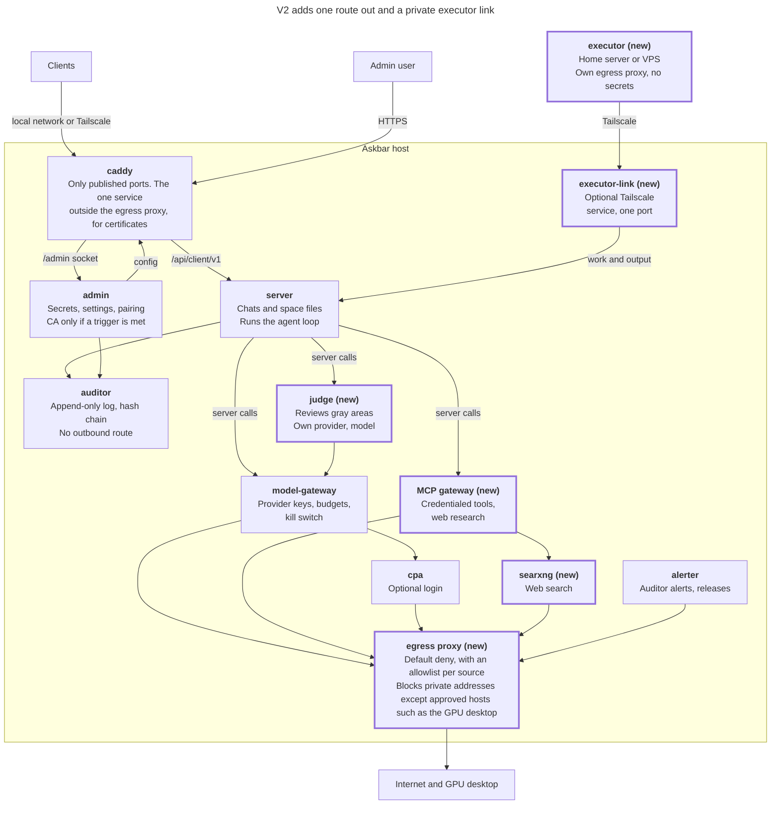

# Plan: after v1

Status: tracker for work after 1.0. The order and rules are decided in [ADR 0019](adr/0019-post-v1-order-and-tools.md) (egress proxy, then web research with the judge, then the executor) and [ADR 0020](adr/0020-remote-executor-and-ca-triggers.md) (executor pairing, tunnel, CA triggers). This file keeps the v2 picture and the repo decisions that are not yet an ADR. Container hardening proposals are in [plan-container-hardening.md](plan-container-hardening.md).

## V2 sketch

V2 adds an egress proxy, web research with a judge, and then an executor, all under the v1 trust model. The server still runs the agent loop, so each tool action passes through a single audited point. The admin still pushes configuration, services still append to the auditor, the controller stays dropped, and the admin stays on one host name unless a later decision changes that.

Thick outline and "(new)": new in v2.

## Open repo decisions

Not decided anywhere yet. Each becomes an ADR, a rule in [AGENTS.md](../AGENTS.md) or [CONTRIBUTING.md](../CONTRIBUTING.md), or an issue.

- **Swift app conventions.** Decide when the iOS app starts: `swift-format` or `SwiftLint`, and the same error-code mapping as the desktop app.
- **An accessibility baseline for the popup.** Not decided anywhere. Suggest: every action reachable by keyboard (already true), visible focus, and contrast checked in both themes (`scripts/check-ui-tokens.sh` already checks the token contrast).
- **AI attribution.** Keep a `Co-authored-by:` trailer on agent commits so history shows it. Recommended; not written into CONTRIBUTING.md.
- **Keeping the rules alive.** Add a rule only after something went wrong or was debated, and add the check that catches it in the same change. A rule with no command that verifies it belongs in a review checklist, not in AGENTS.md. Recommended; not written into CONTRIBUTING.md.
