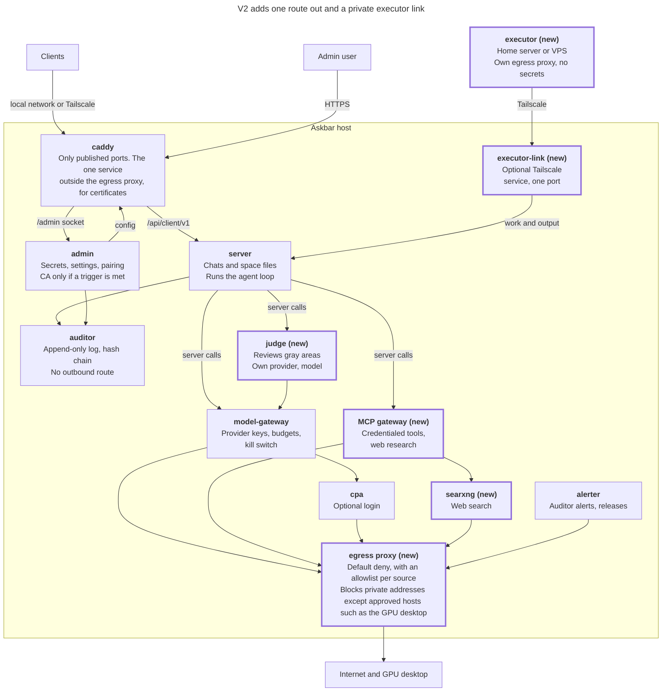

# Plan: after v1 and open repo work

Status: tracker for work not yet built or decided. The order and rules for post-v1 work are decided in [ADR 0019](adr/0019-post-v1-order-and-tools.md) (egress proxy, then web research with the judge, then the executor) and [ADR 0020](adr/0020-remote-executor-and-ca-triggers.md) (executor pairing, tunnel, CA triggers). This file keeps the v2 picture and the repo work around it. Hardening work is in [plan-container-hardening.md](plan-container-hardening.md).

## V2 sketch

V2 adds an egress proxy, web research with a judge, and then an executor, all under the v1 trust model. The server still runs the agent loop, so each tool action passes through a single audited point. The admin still pushes configuration, services still append to the auditor, the controller stays dropped, and the admin stays on one host name unless a later decision changes that.

Thick outline and "(new)": new in v2.

## Repo work

- **Merge the rules.** `AGENTS.md`, the ADRs and the architecture documents live on the `docs/contributor-guidelines` branch only. Merge them first, so agents working from `main` can see them.
- **Pinning gaps.** `caddy:2`, `rust:1` and `debian:bookworm-slim` float. `package.json` uses version ranges with no npm lockfile, GitHub Actions use tags, and the Caddy Cloudflare plugin is unpinned ([ADR 0017](adr/0017-dependencies-and-patches.md)).
- **Update tools.** No Dependabot or Renovate config exists. `cpa` is already pinned to a digest.
- **CI.** The current CI does not run `check-isolation.sh` ([ADR 0018](adr/0018-releases-and-migrations.md)).
- **Unverified paths.** The README lists a real certificate through this layout and person-tested pairing as unverified. The `cpa` login endpoints have not been checked against the pinned image.

## Background: the first-run model

[ADR 0007](adr/0007-first-run-and-admin-sign-in.md) follows the pfSense model: limit who can reach the admin page, and ship a published first credential with a forced change. The comparison it came from:

| Area | pfSense | Askbar |
| --- | --- | --- |
| Who can reach it | [Default deny on WAN, default allow on LAN](https://docs.netgate.com/pfsense/en/latest/firewall/best-practices.html) | Private addresses only. The admin can add Tailscale later |
| Encryption | [HTTPS with a self-signed certificate from first boot, and a redirect from port 80](https://docs.netgate.com/pfsense/en/latest/config/advanced-admin.html) | The same |
| First credential | [Default login](https://docs.netgate.com/pfsense/en/latest/solutions/netgate-4200/initial-configuration.html), then a wizard password step | Published initial credentials, then a wizard password step |
| After setup | [Anti-lockout rules keep the GUI reachable on LAN](https://docs.netgate.com/pfsense/en/latest/config/advanced-admin.html) | Allowlist stays on for private addresses, and can be widened in settings |
| Recovery | [Console options reset the admin account or restore factory defaults](https://docs.netgate.com/pfsense/en/latest/config/console-menu.html) | A host or console command does both, and each reset is recorded in the audit log |

The rule that rejects the default password or one matching the username follows [pfSense Plus](https://redmine.pfsense.org/issues/15266).
