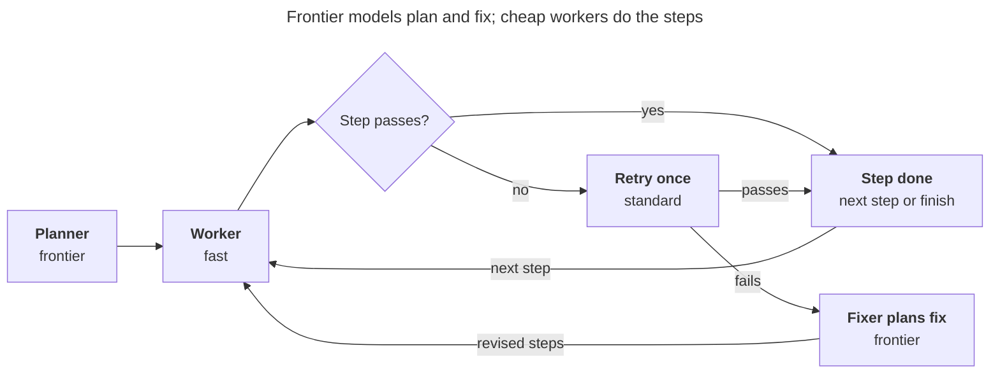
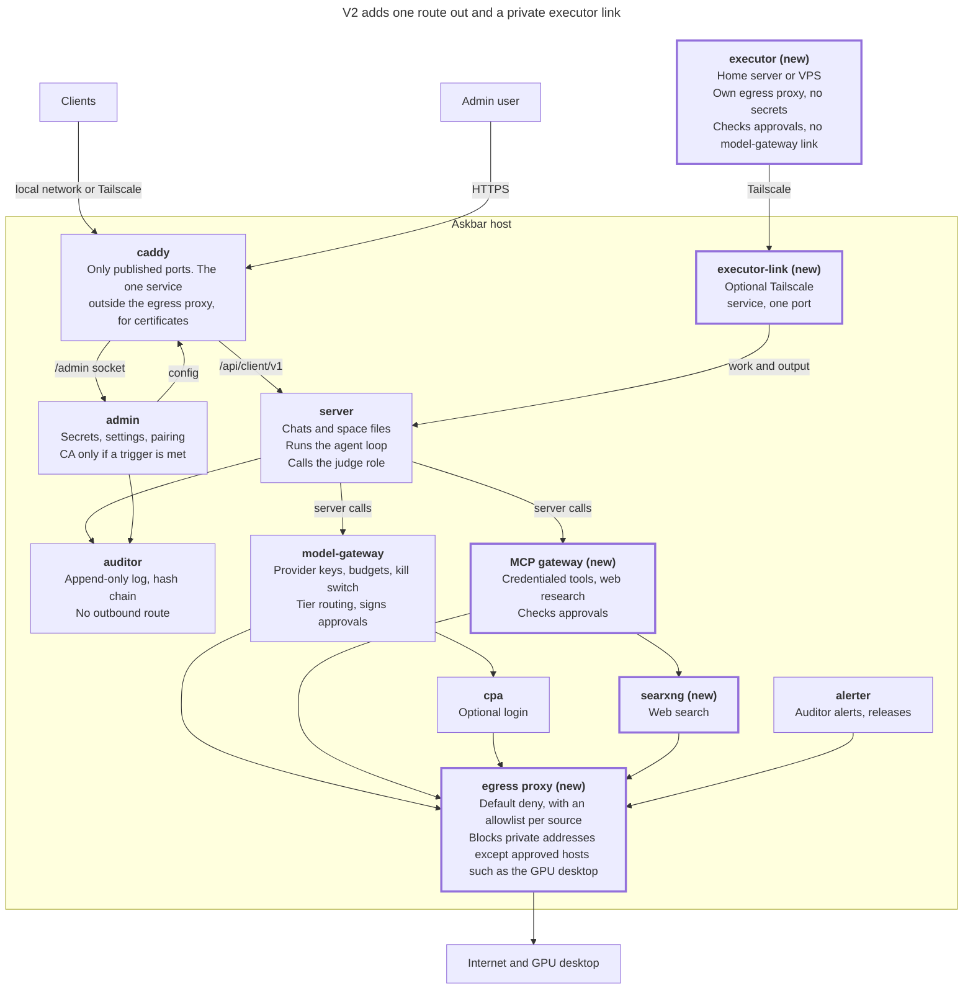

# Plan: tiered model routing

Status: proposed design for after 1.0, to become [ADR](adr/README.md) 0055. Nothing here is decided until that ADR and the amendments listed under [ADR updates](#adr-updates) are accepted.

## Summary

`model-gateway` sends each model call to the cheapest model that can handle it. Models are grouped into three tiers and ranked by cost; a local classifier picks the tier for chat, and fixed roles pick it for agents, research and the judge. Every tool action needs an approval the gateway signs after the judge reviews it.

It ships first after 1.0, before the egress proxy. Keys, budgets, the kill switch, the approved model list and audit-before-call stay in the gateway, and no prompt goes to an outside router.

## Decisions

| Area | Decision |
| --- | --- |
| **Models** | |
| Tiers | `fast`, `standard`, `frontier`, each a list of approved models; the gateway suggests each model's tier and the admin confirms |
| Weights | 1 to 100, from price by default so local models rank first; the admin can override |
| Prices | Set by the admin per model; all budgets and caps are in dollars |
| Effort | Auto by default; the user can pick low, medium or high per conversation |
| Fallback | Automatic within a tier, before the first token only; never local to cloud unless allowed |
| **Chat** | |
| New chats | Start on Auto once shadow mode ends; a chosen model skips routing |
| Sticky tier | Auto only moves a conversation's tier up, except for the budget step-down |
| User control | The client shows the tier and lets the user change it; no floor setting |
| Classifier | `bge-small-en-v1.5` (int8) in the gateway; `all-MiniLM-L6-v2` if it misses 20 ms |
| Training | Owner labels 300 examples; go live under 5% frontier-to-fast misses and below always-`standard` cost |
| Training share | Automatic by default, or ask; deleted with the user, even after labeling |
| **Agents and research** | |
| Roles | Each uses its tier, or a model the admin pins |
| Failed step | Retry once on `standard`, then the frontier fixer |
| Provider error | Fall back in the tier; if all fail, stop as interrupted with a Resume button |
| Tool calls | 8 per task by default (1 to 32) |
| Writer | May call tools to build and deliver the report; no memory writes for now |
| Task state | Kept in the space's SQLite file |
| **Safety and cost** | |
| Judge | Reviews every tool action; tool containers refuse actions without a gateway-signed approval |
| Chat budget | Alert at 75%; step Auto down a tier at 90% |
| Task budget | Strict cap; no step-down mid-task; alerts at 75% and 90% |
| Subscriptions | Track 5-hour and weekly limits; alert at 75% and 90%; demote an account's models near the limit |
| Order | Tiered routing first after 1.0, then the egress proxy |

## Models and tiers

Each tier holds one or more approved models. Code and settings name a tier or a role, never a provider, so changing models is an admin edit.

**Tier suggestion.** When the admin approves a model, the gateway suggests its tier: from its price band for a paid model, from the parameter count Ollama reports for a local one. The admin confirms.

**Price.** The admin enters input and output prices per million tokens for each model. A subscription model through `cpa` has no per-token price, so the admin enters an equivalent or 0.

**Weight.** Each model gets a weight from 1 to 100, from its blended price (60% input, 40% output). The cheapest model in the tier gets 100:

```math
w = 100 \cdot \frac{p_{\min} + 0.01}{p + 0.01}
```

The 0.01 keeps a free model from pushing paid ones to zero: a local model at $0 gets 100, and a paid one at $1 gets about 1. The admin can override any weight; the admin page shows default and override side by side.

**Choosing.** The gateway uses the highest-weighted model in the tier that isn't marked unavailable; ties go to the lower price. A conversation keeps its model while it stays in the tier.

**Fallback.** If a model fails before its first token, the gateway tries the next-weighted model in the tier, up to 3 tries.

- A model that keeps failing is skipped for 5 minutes.
- Fallback never leaves the tier and checks the cost cap before each try.
- It never sends a local model's prompt to a cloud provider unless the admin allows it.
- Once a reply is streaming, a failure ends the call.

**Effort.** The admin lists the effort levels each model supports, and the gateway maps the level to the provider's field (`output_config.effort` for Claude, `reasoning_effort` for OpenAI-compatible APIs). A missing level falls back to the nearest one, a model with no setting ignores it, and both are recorded.

**Configuration** pushed by the admin (prices are placeholders):

```yaml
routing:
  models:      # USD per million tokens, effort levels, tier, optional weight override
    ollama/local-mid: { input: 0,    output: 0,    effort: [],                  tier: standard }
    provider/small:   { input: 0.10, output: 0.40, effort: [low, medium, high], tier: fast }
    provider/mid:     { input: 1.00, output: 4.00, effort: [low, medium, high], tier: standard, weight: 40 }
    provider/large:   { input: 5.00, output: 20.0, effort: [low, medium, high], tier: frontier }
  roles:
    agent.worker: { tier: fast, retry_tier: standard }
    judge.review: { model: other-provider/large, backup: third-provider/large, effort: high }
  fallback: { max_tries: 3, skip_failing_s: 300, local_to_cloud: false }
  chat_auto: { default_tier: standard, user_ceiling: frontier, cutoffs: { standard: 0.35, frontier: 0.70 }, mode: shadow, training_share: automatic }
  task: { max_tool_calls: 8, cap_mode: strict }
```

A tier, pin or price that names a model outside the approved list rejects the push.

## Roles

Every role is a model call, not a container. The server's loops make the calls and do all the supervising; `model-gateway` picks the model, checks the cost cap and opens the audit span. Tools run in the MCP gateway and executor ([ADR 0019](adr/0019-post-v1-order-and-tools.md)).

| Role | Default tier | Called by the server to |
| --- | --- | --- |
| `chat.auto` | Classifier picks | Answer a chat set to Auto |
| `agent.planner` | `frontier` | Write the steps and the final answer |
| `agent.worker` | `fast`, retry on `standard` | Run one step |
| `agent.fixer` | `frontier` | Revise steps after a failed retry |
| `research.researcher` | `fast` | Search, fetch and summarize |
| `research.writer` | `frontier` | Write and deliver the report |
| `judge.review` | `frontier` | Approve or refuse each tool action |

**Pinning.** Any role can name one approved model instead of its tier, plus a backup pin for fallback. Pin the judge, and its backup, to providers other than the planner's and workers', so one provider's weakness doesn't fool both.

## Chat Auto

For each message in an Auto chat, the gateway:

1. Runs the kill switch, user pause and approved-list checks, as today.
2. Scores the latest user turn from 0 to 1, and turns the score into a tier with the cut-offs.
3. Keeps the conversation's current tier and model if the new tier is lower: Auto only moves up.
4. Caps the tier at the user's ceiling.
5. Steps down one tier if the user is past 90% of the monthly budget.
6. Sets effort: the user's choice if any, otherwise from turn length, context size and tool-loop depth, fixed for the whole turn.
7. Opens the audit span with the decision record, then calls the provider.

If the classifier fails or takes over 20 ms, the gateway uses `default_tier` and records why.

**In the client.** Each reply shows its tier. The user can change the conversation's tier (within their ceiling) and its effort (Auto, low, medium or high); both stick until changed, and Auto stops moving a tier the user set. "Ask again on a stronger model" re-sends the question one tier up.

**Training.** The admin stores the labeled examples and pushes them, and the gateway retrains on each push in seconds.

1. **Label:** the owner writes or imports examples and tags each with a tier; shared re-asks join a review queue.
2. **Check:** the gateway holds back 20% and reports accuracy, frontier questions sent to fast, and cost against always-`standard`, then suggests cut-offs.
3. **Shadow:** the new set records its picks while the current one routes.
4. **Go live or roll back:** each push raises the configuration version; earlier sets stay in the admin.

A dry-run panel in the admin shows the score, cut-offs and tier for any test prompt.

## Agents

A frontier planner writes the steps, cheap workers run them, and a frontier fixer steps in only after a retry fails. Ships with the executor.



- **Planner:** returns steps, each with its inputs, its allowed tool and an acceptance check, and writes the final answer.
- **Worker:** sees only its step and the context it needs, which is where most of the saving comes from.
- **Tool calls:** each goes through the judge and carries a signed approval, and counts toward the task's limit.
- **Checks:** deterministic where possible (exit code, tests, schema); otherwise the planner reviews the result.
- **Retry:** a failed check reruns the step once on `standard`; a second failure goes to the fixer. A second fixer round on one step ends the task.
- **Provider error:** the gateway falls back within the tier; if every try fails, the task stops as `interrupted` and the client shows Resume.
- **Stops** at the tool-call limit or the cost cap; the planner then answers from what is done.

## Research reports

Cheap researchers gather in parallel; one frontier writer turns their summaries into a report. Ships with web research, under [ADR 0019](adr/0019-post-v1-order-and-tools.md)'s controls.

1. **Split:** the writer turns the question into 2 to 4 research questions, or one for a short question.
2. **Research:** each researcher searches and fetches within the user's permissions, and returns a summary of at most 800 tokens with its URLs.
3. **Wait:** once 2 summaries arrive, wait up to 8 s for the rest; stop the stage at 90 s.
4. **Write:** the writer gets the summaries as Source 1, Source 2…, notes agreement, conflicts and gaps, and streams a cited report.
5. **Degrade:** no summaries fails the request; one gives a report marked single-source.

The writer may call the tools it needs to build and deliver the report, each through the judge. It can't write memory for now.

## Judge and tool approvals

The judge reviews every tool action, and no tool runs without an approval `model-gateway` signed. Reviewing everything removes the need to define a "gray area", and the signature means even a compromised server can't run an action the judge never saw.

1. **Fixed rules:** the server applies [ADR 0019](adr/0019-post-v1-order-and-tools.md)'s rules; a failure refuses the action.
2. **Review:** the server sends `judge.review` the tool, its exact arguments and destination, the user's original request and the plan step, never fetched pages or tool output.
3. **Verdict:** approve or refuse with a reason code, in a fixed format; anything else is a refusal.
4. **Sign:** on approval, the gateway signs a hash of the exact action, the task, the user, a one-time ID and a 60-second expiry, and records it.
5. **Verify:** the MCP gateway or executor checks the signature, hash, expiry and one-time ID before running; anything else is refused and recorded.

**Rules**

- The signing key lives in the gateway's memory only, pushed by the admin like provider keys. Tool containers hold the public key: the MCP gateway in its configuration, the executor from pairing ([ADR 0020](adr/0020-remote-executor-and-ca-triggers.md)).
- Fail closed: if the judge is unavailable, over budget or out of format, the action is refused.
- Tool containers also enforce the fixed rules they can check themselves (the MCP gateway knows its own search results; the egress proxy denies by default).
- The executor never calls the judge and has no link to `model-gateway`; it only verifies signatures.

**Limits.** This stops a compromised server from running an unreviewed action, swapping one after approval, or replaying an approval. It can still ask the judge to approve a crafted action, so the judge and the containers' own rules remain the barrier there. It costs one frontier call per tool action; moving the judge to `standard` would cut that at some loss of protection.

## Task state

The server keeps each agent or research task in the space's SQLite file, so only the space's members can read it, and it is backed up, migrated and deleted with the conversation ([ADR 0009](adr/0009-spaces-and-storage.md)).

| Table | Holds |
| --- | --- |
| `tasks` | ID, conversation, kind, status (`running`, `done`, `stopped`, `interrupted`), tool calls used, cost so far, cap |
| `task_steps` | Step number, role, instructions, each attempt with its `decision_id` and outcome, check result, output |

A step's row is written before the step starts and updated when it ends. On start, the server marks any `running` task `interrupted`. Resume continues from the next unfinished step; a step that was cut off reruns only after the user confirms, because its tool calls may already have happened.

## Budgets and subscription limits

### Budgets

Budgets and caps are in dollars, from the admin's prices. Routing can lower cost but never pushes past a budget, and never runs a call it can't audit.

- **Chat:** alert the admin at 75% of a user's monthly budget, step Auto down one tier at 90%, stop at 100% as today. A tier the user chose isn't stepped down.
- **Tasks:** each task has a cost cap, checked before every step and every fallback try. A step that doesn't fit is refused with a `problem+json` 402, and the task stops with its results saved. Tiers don't change mid-task; the user and admin get alerts at 75% and 90% of the task cap and the monthly budget.
- **Fail closed:** only approved models, no random exploration; a routing error falls back to `default_tier` and is recorded; a bad configuration rejects the push.

### Subscription limits

Claude and ChatGPT subscriptions behind `cpa` have 5-hour and weekly limits. `cpa`'s normal API doesn't report them, but its management API, which the admin already calls ([ADR 0042](adr/0042-cpa.md)), can. Every 5 minutes the admin lists the accounts (`GET /v0/management/auth-files`) and reads each one's usage through `POST /v0/management/api-call`, where `cpa` inserts the account's token so the admin never holds it. The admin calls only these two addresses:

| Provider | Address | Returns |
| --- | --- | --- |
| Claude | `api.anthropic.com/api/oauth/usage` | 5-hour and 7-day percent used and reset times, plus 7-day figures per model family |
| ChatGPT (Codex) | `chatgpt.com/backend-api/wham/usage` | 5-hour and weekly percent used and reset times |

Neither is a documented API. A failed read shows "unknown" and alerts once; it never blocks model calls.

- **Alerts:** at 75% and 90% of either window, once per window, through the `alerter`.
- **Tokens left:** providers report percentages, not tokens. The admin divides the tokens Askbar sent to an account, per model, by the change in percent between reads, and shows the tokens left per window and model. If the percentage moves without Askbar traffic (the subscription is used elsewhere), the estimate is marked low-confidence.

```math
\text{tokens per 1\%} = \frac{\text{tokens used since last read}}{\text{percent change}} \qquad \text{tokens left} = (100 - \text{percent used}) \times \text{tokens per 1\%}
```

- **Routing:** at 90% of either window the admin lowers that account's models to weight 1, and at 100% marks them unavailable until the reset. Each change is a recorded admin action, and the admin can turn this off.

## Audit and privacy

**Decision record.** Every span start gains routing metadata, never prompt text, so routing can be reviewed without opening sealed content. The gateway returns `decision_id` with each reply, and the admin looks decisions up with its audit read token.

| Field | Example |
| --- | --- |
| `decision_id`, `config_version` | `rd_01J…`, 7 |
| `role`, `requested`, `model` | `chat.auto`, `auto`, `provider/small` |
| `score`, `tier_raw`, `tier_final` | 0.31, `standard`, `fast` |
| `reasons` | `sticky`, `user_choice`, `budget_stepdown`, `classifier_timeout`, `worker_retry`, `fallback` |
| `effort`, `estimated_cost` | `low`, $0.0004 |
| `task_id` | Links the steps of one task |
| `verdict`, `approval_id` | For `judge.review`: `approve` and the approval's one-time ID |

**Training share.** The one path where prompt text reaches the admin outside a sealed-content session:

- The server sends a re-asked question to the gateway marked for sharing; the gateway holds it in a small in-memory queue, and the admin collects it over its own link. The server never calls the admin.
- On `automatic`, the privacy notice says so and each shared message is marked in the client; on `ask`, the re-ask button asks first.
- Each share is an audit record (user, time, decision ID) without the text.
- Shared questions live in `admin.db`, labeled or not, and are deleted with the user.

## Changes, API and rollout

| Component | Change |
| --- | --- |
| `model-gateway` | Classifier, routing, weights, effort mapping and fallback; prices and pins; signs approvals with a key held in memory; ONNX Runtime and weights in the image; the 256 MB memory limit measured and likely raised; admin routes for dry-run and the share queue |
| `server` | Agent and research loops; judge calls for every tool action; task tables in each space file; sends role, task, effort and share flag |
| `admin` | Routing page: models with suggested tiers, weights and overrides, prices, effort levels, pins, cut-offs, ceilings, caps, training share and examples. Creates and pushes the signing key; reads subscription limits from `cpa`; spend by tier and role |
| MCP gateway, executor | Verify each approval before running an action; the executor gets the public key at pairing |
| Desktop client | Auto in the model picker; tier and effort controls on each conversation; the re-ask button; the shared marker; Resume for interrupted tasks |

**API (additive).** `POST /chat` takes `role`, and optionally `tier`, `task_id`, `effort` and a share flag; a named `model` still wins. The first SSE event adds `decision_id` and `tier_final`. The client API accepts `model: "auto"` and a per-conversation tier and effort. New problem types cover a task over its cap (402) and a missing or bad approval.

**Rollout, first after 1.0:**

1. **Records only:** models, tiers, prices and decision records, with chosen models; no behavior change.
2. **Shadow:** the classifier records its pick while users' models route.
3. **Auto by default:** for new chats, once the go-live bar is met.
4. **Egress proxy** ([ADR 0019](adr/0019-post-v1-order-and-tools.md)).
5. **Research reports and the judge:** with web research.
6. **Agents:** with the executor.

## ADR updates

One new ADR and fourteen amendments, checked against ADRs 0001 to 0054. Decision amendments need the owner's approval in the pull request ([ADR 0001](adr/0001-decision-records-and-change-rules.md) rule 14); description amendments go in with the code.

| ADR | Type | Change |
| --- | --- | --- |
| **0055** (new) | Decision | Tiered model routing and signed tool approvals: this design |
| [0002](adr/0002-v1-scope-limits-and-ship-criteria.md) Scope | Decision | Routing ships after 1.0, outside the 100-hour estimate; the classifier's 20 ms counts toward the 200 ms target |
| [0009](adr/0009-spaces-and-storage.md) Spaces | Decision | A space file also holds the task state of its conversations |
| [0010](adr/0010-auditor.md) Auditor | Decision | Span starts carry the decision record; each agent step is its own span, linked by `task_id`; judge verdicts, approvals, refusals and training shares are recorded |
| [0011](adr/0011-sealed-content-access.md) Sealed content | Decision | One exception: shared training questions reach the admin outside a session, with the notice, marker and a record per share; a compromised admin can read them |
| [0012](adr/0012-consent-notices-and-deletion.md) Consent | Decision | The notice states automatic sharing; shared questions are deleted with the user, labeled or not |
| [0014](adr/0014-model-gateway-and-providers.md) Providers | Decision | The catalog gains tiers of weighted models, a default tier, role pins, and each model's price and effort levels; budgets move to dollars; a conversation may store `auto`; automatic fallback within a tier replaces v1's no-fallback rule after 1.0 |
| [0016](adr/0016-risk-register.md) Risks | Register | Defend: unsigned or replayed tool actions are refused (test). Accept: the admin reads shared questions; a misroute gives a weaker answer; a compromised gateway can shift tiers within budgets and sign any action; the undocumented usage addresses may break |
| [0019](adr/0019-post-v1-order-and-tools.md) Post-v1 | Decision | Order: routing, then the egress proxy. The judge is the `judge.review` role: it reviews every tool action from a fixed input and format, is pinned to its own provider, and its approvals are signed and checked by the tool containers. The writer is a role with tools and no memory writes. Per-role models become role pins |
| [0020](adr/0020-remote-executor-and-ca-triggers.md) Executor | Decision | The executor gets the approval public key at pairing, verifies every action, has no link to `model-gateway` and never calls the judge |
| [0042](adr/0042-cpa.md) cpa | Description | The admin also lists accounts and reads their usage through `api-call`, limited to the two usage addresses |
| [0054](adr/0054-model-gateway.md) Gateway | Description | When built: routes, signing key, prices, fallback, ONNX Runtime and weights, the measured memory limit, retrain on push, the share queue, and a test that a marker prompt in the queue never reaches logs |
| [0039](adr/0039-server.md), [0040](adr/0040-admin.md), [0044](adr/0044-desktop-client.md) | Description | When built: the changes in the table above |

**Checked, no change:** 0006, 0017 (the new libraries and weights need a license reason in the pull request), 0022, 0023, 0028 (the signing key is pushed and held in memory like provider keys), 0032.

## Architecture and plan doc updates

These are docs, not ADRs; each change goes in the same pull request as the ADR it follows.

### docs/architecture.md

- **Components, `model-gateway` row:** add "picks each call's model by role, tier and weight, runs the chat classifier, and signs tool approvals".
- **Post-v1 names:** drop **judge** and add "The judge is a model role the server calls, not a component (ADR 0055)."
- **Other terms:** add or change these rows. The glossary fixes the names every API, setting and label uses, so each entry says what the thing is and does.

| Name | Means |
| --- | --- |
| **space** (changed) | one SQLite file holding a personal or shared space's conversations, history, memory, search, and the state of its agent and research tasks |
| **tier** | one of three cost levels, `fast`, `standard` and `frontier`, each holding approved models ranked by weight; code and settings name a tier, never a provider |
| **weight** | a model's rank within its tier, 1 to 100; it defaults from price, so cheaper and local models rank higher, and the admin can override it |
| **role** | the job a model call does, such as `chat.auto`, `agent.worker` or `judge.review`; it sets a default tier, which the admin can replace with a pinned model |
| **effort** | how much a model reasons before answering: Auto, low, medium or high, mapped to each provider's own setting; higher costs more |
| **Auto** | a chat setting where the classifier picks the tier for each message; the tier only rises within a conversation, and the user can change it |
| **task** | one agent or research run made of steps, kept in the space file so an interrupted task can resume |
| **judge** | the `judge.review` role: it approves or refuses each tool action before it runs |
| **approval** | the gateway's signature over one exact tool action, valid once for 60 seconds; tool containers refuse any action without one |
| **decision record** | the routing metadata on a span start: role, model, tier, score, reasons, effort, cost estimate and, for the judge, its verdict |

### docs/plan-post-v1.md

- **Status line:** the order becomes tiered routing, the egress proxy, web research with reports and the judge, then the executor (ADR 0019 as amended).
- **V2 sketch:** add "The judge and the report writer are model roles the server calls through `model-gateway`. Every tool action needs an approval the gateway signs; the MCP gateway and executor check it, and the executor never calls the gateway."
- **Diagram:** replace it with this one, which drops the judge node and its two edges and names the new duties:



### Project doc: architecture-goals-and-features.md

This is the claude.ai project doc, not a repo file.

- **Clients:** "The user chooses a model for each chat from the admin's approved list" gains "or Auto, the default for new chats, which shows its tier and lets the user change it and the effort".
- **Server:** add "`model-gateway` routes each call to a tier by role and to a model by weight, with budgets in dollars from admin-set prices."
- **Admin:** add "Tracks subscription 5-hour and weekly limits and alerts before they run out."
- **Later:** add tiered routing first, noting it delivers "automatic provider fallback"; "Egress proxy, first after v1" becomes "Egress proxy, after tiered routing"; "shipped with a judge model that reviews gray areas" becomes "with a judge role that reviews every tool action, enforced by signed approvals".

## Sources

- [Claude effort parameter](https://platform.claude.com/docs/en/build-with-claude/effort) and [OpenAI reasoning guide](https://developers.openai.com/api/docs/guides/reasoning): per-request effort settings.
- [stream-micro PR 12](https://github.com/cropse/stream-micro/pull/12): reading subscription usage through `cpa`'s `auth-files` and `api-call`.
- [cship usage limits](https://docs.rs/crate/cship/1.6.0/source/src/usage_limits.rs) and [codex-lb usage API](https://mintlify.com/Soju06/codex-lb/api/codex-usage): fields of the Claude and Codex usage responses.
- [OmniRoute Auto-Combo docs](https://cdn.jsdelivr.net/gh/diegosouzapw/OmniRoute@main/docs/routing/AUTO-COMBO.md): planner/executor pipeline, panel fan-out, strict cost caps, request-shape effort.
- [OmniRoute fork release notes](https://github.com/LMPrado-DZ23/OmniRoute/releases): decision IDs on routed responses.
- [LiteLLM auto routing benchmark](https://docs.litellm.ai/docs/proxy/auto_routing_benchmark.md): learned routing beat rule-based scoring.
- [mmrouter](https://pypi.org/project/mmrouter/): budget-based tier step-down.
