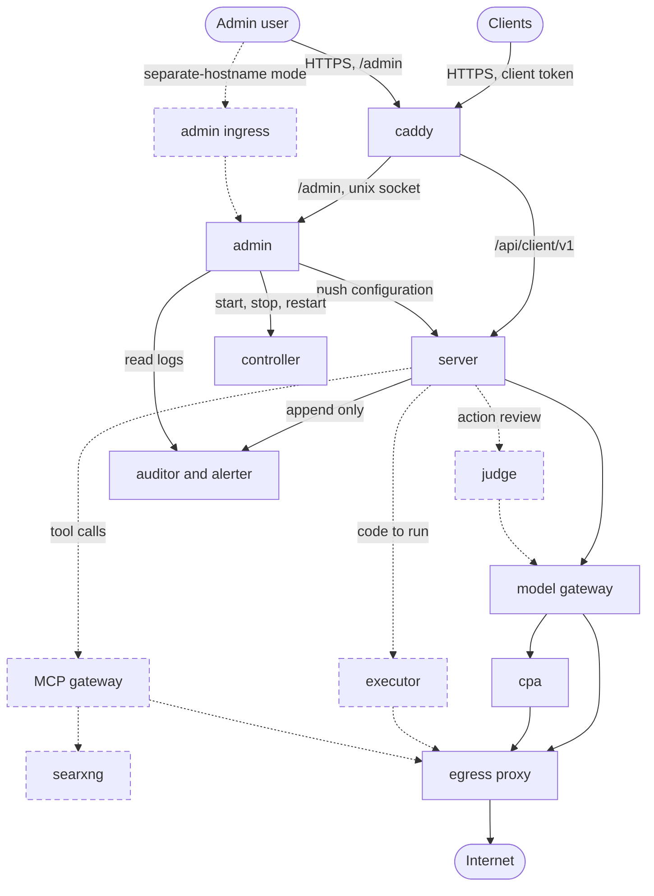

# Re-architecture

Status: Proposed, for review. Nothing here is built or decided.
Date: 2026-11-04

This is the repo version of the 2026-11-04 design review of the goals document. It extends [ADR 0003](adr/0003-admin-and-server-isolation.md), [0007](adr/0007-conversation-only-and-tool-gating.md), [0008](adr/0008-admin-sign-in-and-exposure.md), [0009](adr/0009-the-auditor.md) and [plan-container-hardening.md](plan-container-hardening.md). Where it disagrees with an accepted decision or a hard rule in [AGENTS.md](../AGENTS.md), the table says so, and that item needs an ADR before any code. [architecture.md](architecture.md) stays the description of what `main` does until a step below lands.

## Goal

Grow the core (`caddy`, `server`, `admin`, `controller`, `cpa`) toward the goals document, in the owner's priority order: a compromised server, then a compromised admin, then any path a model could use to break out. Web research and code execution come after 1.0 ([ADR 0007](adr/0007-conversation-only-and-tool-gating.md)).

## Names

A new component gets a name and an ADR before it exists ([ADR 0002](adr/0002-one-name-per-role-one-host.md)). The review used working names. Where two names mean one role, this document uses the glossary's.

| Review name | Name here | State |
| --- | --- | --- |
| Ingress (Caddy) | `caddy` | built |
| Orchestrator | `server` | built; renaming is decision 5 |
| Admin | `admin` | built |
| Controller | `controller` | built |
| CLIProxyAPI | `cpa` | built |
| Auditor and alerter | `auditor` (the alerter is a process inside it) | proposed, [ADR 0009](adr/0009-the-auditor.md) |
| LLM gateway | model gateway | proposed, hardening plan item 7 |
| Network gateway | egress proxy | proposed, hardening plan item 5 |
| Admin ingress | admin ingress | new; exists only in separate-hostname mode |
| Judge | judge | new, after 1.0 |
| Executor | `executor` | reserved word, [ADR 0007](adr/0007-conversation-only-and-tool-gating.md) |
| MCP gateway | MCP gateway | new, after 1.0 |
| SearXNG | `searxng` | third party; runs behind the MCP gateway |

## Target

Dashed boxes and arrows come after 1.0.

- Only `caddy` publishes a port. The egress proxy is the only route out.
- Every link is listed; a missing arrow is a blocked path. Nothing calls the admin. The admin pushes configuration to every component and reads the auditor.
- Every component except the admin appends to the auditor with its own credential. The model gateway, executor and MCP gateway refuse work when the auditor is unreachable (fail closed, as in ADR 0009). The diagram shows only the server's arrow.

## What changes

"Needs" says where it is recorded or what must happen first. "Decision N" points to the list below.

| Area | Today | Target | Needs |
| --- | --- | --- | --- |
| Audit store | `audit.db` in the server, triggers, no hash chain, events can be lost | `auditor` container, append only by API, hash chain, fail closed, retention floor 7 days | [ADR 0009](adr/0009-the-auditor.md), proposed |
| Alerter | none | a process in the auditor container. Rules: budget spike, denied egress, failed sign-ins, settings or retention change, no logs from a component for N minutes, auditor disk use. Delivery by ntfy, Pushover or email through the egress proxy. An hourly dead-man ping to an external monitor. Every rule edit is logged and alerts | extend ADR 0009 or a new ADR. It lives in the auditor so a compromised admin cannot switch off the rules that would catch it |
| Secrets | the server keeps provider keys under `master.key` | the admin holds every secret; the server holds none at rest ([ADR 0003](adr/0003-admin-and-server-isolation.md)); later the model gateway holds provider keys, budgets and the kill switch | ADR 0003, proposed; hardening plan item 7 |
| Outbound traffic | `edge` has a full route out; the server calls providers directly | the egress proxy is the only route out. Default deny, a separate allowlist per source, owns DNS, blocks private, link-local and cloud-metadata ranges. Enforced by `internal` networks, never by proxy environment variables | hardening plan items 5, 7 and 8 |
| Service identity | a token hash and a first-contact claim from a fixed address ([ADR 0003](adr/0003-admin-and-server-isolation.md)) | a private CA run by the admin. Every link is mutual TLS with a certificate named for its component, about 24 hours long, renewed by the admin. Each receiver allowlists caller names. Revoking a component means not renewing it and pushing a deny list. Components boot unconfigured and the admin pushes their configuration, as `503 not_configured` already does for the server. Each component records "config applied, hash X" in the auditor, so the admin is not the only witness to its own changes | Decision 1. ADR 0003 rejected mutual TLS for two containers; twelve change the cost |
| Admin sign-in | password, admin API key, address allowlist off by default | passkeys first, offline recovery codes as the backup, the allowlist asked about at first run. Secret changes, permission changes, retention changes and opening sealed content need a fresh sign-in | [ADR 0008](adr/0008-admin-sign-in-and-exposure.md), proposed. It keeps the password as the backup; recovery codes differ (decision 8) |
| Admin address | one host name, `/admin` through `caddy` over a unix socket | one URL by default. A switch in the admin moves the admin to its own host name through an admin ingress container with its own Cloudflare token and certificate, and `caddy` answers 404 for `/admin`. The token is worth having only because it sits in a different container from `caddy`'s. Passkeys use the base domain as their relying party ID, so they survive the switch | Decision 2. Reverses ADR 0002 decision 3 and the "no second domain or certificate" rule in AGENTS.md |
| Controller | starts, stops and restarts `server`, `caddy`, `cpa` | the same, plus the new components, never the admin or the auditor. Every action is logged to the auditor | Decision 6. The allow list is a hard rule ([ADR 0005](adr/0005-docker-socket-only-in-controller.md)) |
| Emergency stop | the kill switch setting makes the server refuse replies | a host script, `scripts/askbar-stop.sh`, that works with the admin, the controller and the network down. Level 1 pauses: stops the egress proxy, model gateway, executor and MCP gateway, while the server tells clients "paused". Level 2 also revokes every client token through a server command. Level 3 stops everything except the auditor. Alert rules may trigger level 1 for one user or all. Named apart from the kill switch so that word keeps one meaning | new |
| Users and data | one `askbar.db` with `user_id` on every table | a control database (users, clients, permissions, budgets, pairing hashes) and one SQLite file per user (history, memory, settings, FTS5). Handlers receive a per-user store, never a raw connection, so a missing `WHERE user_id` cannot leak across users. Existing rows are moved once by an appended migration. This fits tens of users, not thousands | Decision 4 |
| Pairing | a 10-minute single-use code, hash pushed in the snapshot | add: the client makes a keypair in the Secure Enclave or OS keychain and registers its public key; strict rate limit and attempt cap on the pairing endpoint; identical errors for every failure | additive within `v1`; [wire-contract.md](wire-contract.md) |
| Per-user permissions | token limits and the kill switch | add: allowed models, executor on or off, allowed tools, egress profile. A chat-only family account has the executor and tools off | additive; the tool parts wait for 1.0 |
| Backup | one `.tar` with `server.db` and `admin.db`, secrets left out, the audit volume copied by hand | one age-encrypted file made by the admin: a snapshot from every component (`VACUUM INTO`), CA keys, secrets and a manifest of hashes. A `verify` action checks it without restoring. A restore is accepted only into an empty, unconfigured install and only from the admin. The recovery key is shown once | Decision 3. Contradicts "backups hold no secrets" in [SECURITY.md](../SECURITY.md) and `scripts/check-isolation.sh` |
| Container hardening | the controller only | every service, per hardening plan items 1 and 2, as one shared Compose block so a new service starts hardened | [plan-container-hardening.md](plan-container-hardening.md) |

## Tools, after 1.0

[ADR 0007](adr/0007-conversation-only-and-tool-gating.md) applies first: no tool exists without its own ADR, and its six invariants hold from the first commit.

- **The agent loop stays in the server.** The executor runs what it is handed and returns output. It never calls a model, an MCP server or the server, so every action passes the server, where the audit span and the judge see it.
- **Judge.** Its own container, no tools, no data access, a route only to the model gateway. It reads untrusted text and can be prompt-injected, so it is not a security boundary. Permissions come from deterministic rules: tool allowlists per user, egress allowlists, budgets. The judge covers gray areas only, with a fixed prompt, structured output, and a different model or context from the agent.
- **Executor.** One ephemeral sandbox per task, under gVisor (`runsc`). Firecracker needs KVM and its own manager, so it does not fit a plain Compose file. No secrets, no tokens, no Docker socket, CPU, memory and time limits. It runs as a network service with mutual TLS, on the same host or on other hardware. A remote executor makes its own key and a signing request, the admin signs it, and the key never leaves that machine. It runs its own egress proxy instance, so egress stays allowlisted and logged there too.
- **MCP gateway.** One container per MCP server, each with its own minimally scoped credential. Credentials are shared and set by the admin at first; per-user credentials come later. Pin server versions and alert when a tool description changes. Tool descriptions and results are untrusted. Only the server calls it, never the executor. A stdio MCP server is arbitrary code execution.
- **Web research.** `searxng` and a `web_fetch` tool run as MCP servers. `web_fetch` needs SSRF protection, size and time limits, and its output is tagged untrusted.
- **Memory.** Entries carry provenance. Text from a fetched page cannot write memory or trigger a tool call without confirmation. Memory stays append-only so it can be rolled back.

ADR 0007 needs three amendments: tools run in two containers, not one (the executor for untrusted code, the MCP gateway for credentialed tools, because the two must never share a container); the executor is reached as a network service; and web research comes first, since it needs no code execution. Decision 7.

## Decisions for the owner

Recommendation first.

1. **Service identity.** Keep claims ([ADR 0003](adr/0003-admin-and-server-isolation.md)) or move to a CA and mutual TLS. Recommend the CA, decided before ADR 0009 is accepted, because 0009 is written around claims. A claim needs a first-contact window per link and a source-address check that holds only if every container drops `NET_RAW`; each new component adds another. The CA gives revocation. The cost is a bootstrap job, certificate renewal, and the admin having to be up after a reboot (already true under ADR 0003).
2. **Admin address.** The owner asked for the separate-hostname switch on 2026-11-04. It reverses the rejected alternative recorded in ADR 0002 the day before. Confirm, then supersede ADR 0002 decision 3 and change the AGENTS.md rule. Turn the allowlist on by default in one-URL mode.
3. **Backup contents.** Include secrets under age encryption, or keep them out and re-enter them after a restore. Recommend including them: once ADR 0003 lands the admin holds every secret, and one file that restores everything is the point. The file becomes the most sensitive object you own. SECURITY.md, the README and the isolation script change with it.
4. **Storage.** One shared database or per-user files. Recommend the hybrid above: an error in one user's file cannot reach another's, and deleting or exporting a user is one file.
5. **Name.** Keep `server`. Renaming it "orchestrator" touches the crates, the container, the `/api/server/v1` prefix, the glossary and ADR 0002, and adds no security.
6. **Controller allow list.** Add the new components, never the admin or the auditor, so a compromised admin cannot stop the audit.
7. **ADR 0007 amendments** above.
8. **Admin backup sign-in.** Recovery codes instead of a password, so a weaker path cannot undo the passkey. ADR 0008 keeps the password.

## Build order

Each step ships alone, with its tests and docs in the same commit. Run `scripts/check-isolation.sh` for any step that touches who can reach what.

0. Decide 1 and 2. Accept ADRs 0002, 0003, 0008 and 0009 as amended.
1. Harden every container (hardening plan items 1 and 2).
2. Service identity: the CA bootstrap job and mutual TLS on the existing links.
3. The auditor, then the alerter and the dead-man ping.
4. The egress proxy, then the model gateway, then the independent records (hardening plan item 8).
5. Admin: passkeys, the address switch if confirmed, the emergency stop script, the backup rework.
6. Users: the control database and per-user files, pairing key binding.
7. After 1.0, one ADR each: MCP gateway with `searxng`, then judge and executor.

## Not changed

Conversation only through 1.0. Sealed audit content, 30 days of retention, a floor of 7. The `/api/client/v1` contract and the one error shape. Secrets never in `.env`, logs or errors. One host name by default.
