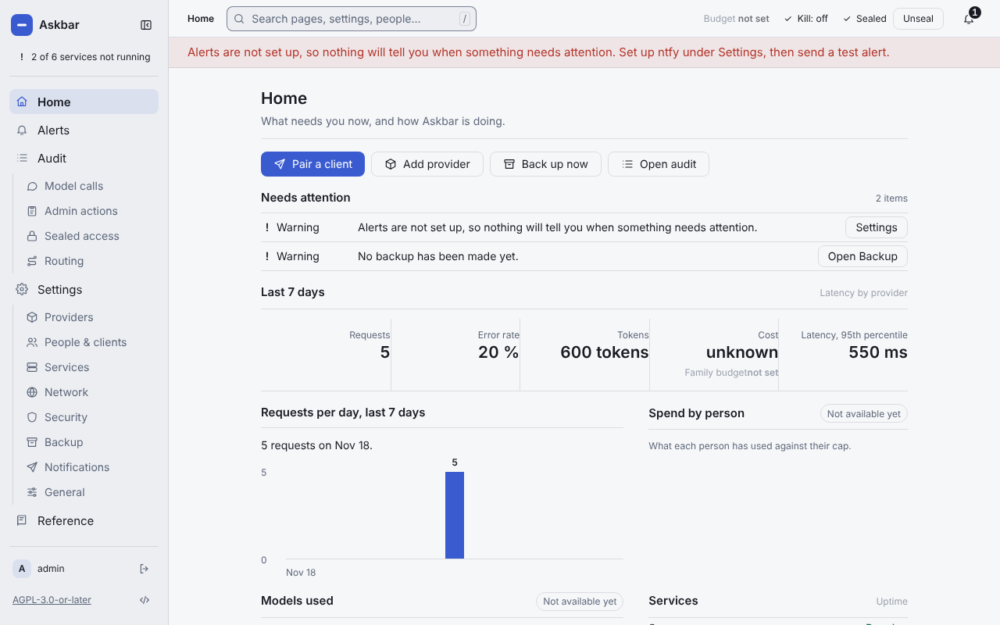
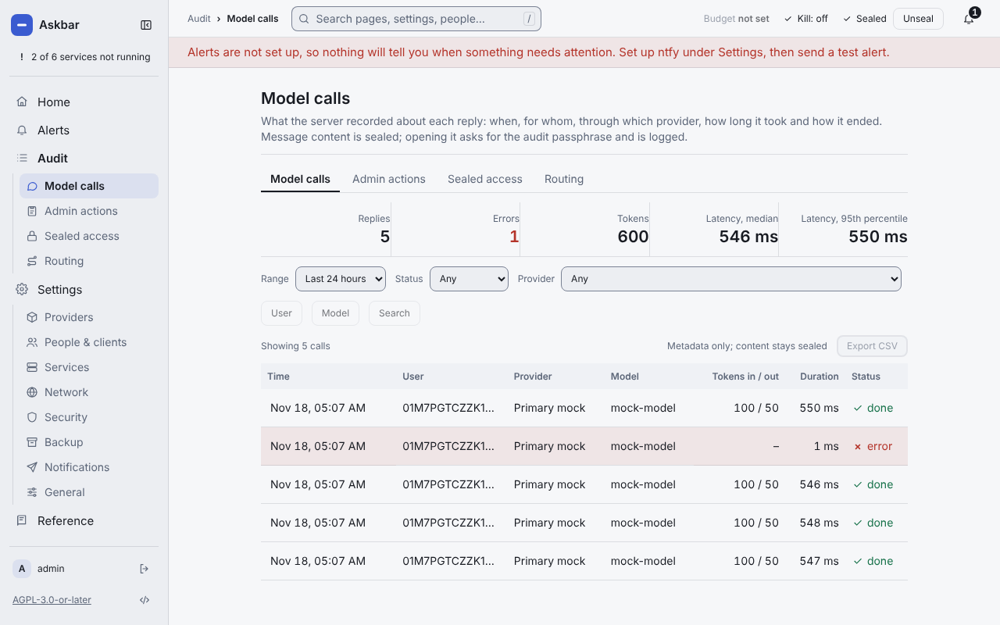
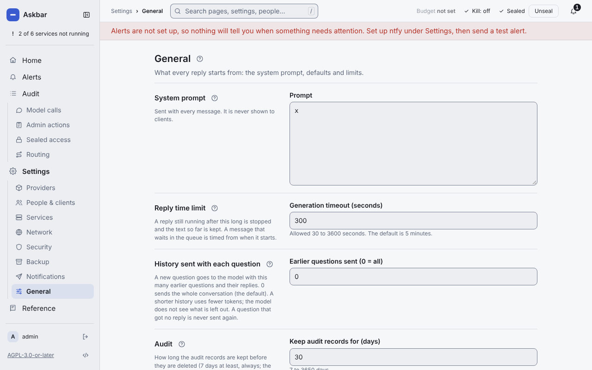
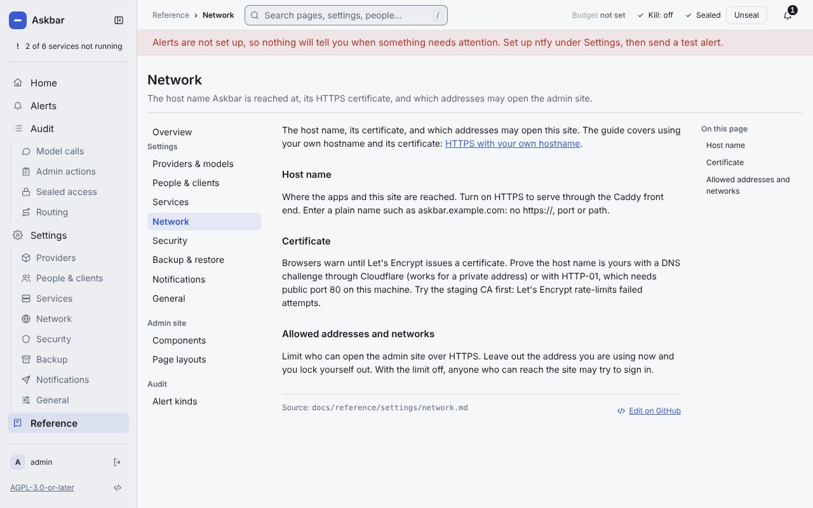

# Page layouts

Every admin page sits in one frame: the side menu, the status bar and the page header, with the page's sections in `main`. The frame is `services/admin/src/ui/templates/base.html`. Beyond the frame, the pages use these layouts. The components they are built from are on [Components](components.md). In the admin, each layout is followed by a small diagram made from the admin's own styles; GitHub does not show them.

The screenshots on this page come from `tests/e2e/page-shots.js` (`npm run shots -- --docs`), run on a throwaway stack with sample traffic.

## Index

The overview of a group of pages: one line for each item, with what it is set to now. The Settings page is the index of the settings pages (`settings.html`).

<!-- live: layout_index -->

## List pages

A table or list of records, with a heading and a hint under the title. The audit pages are lists: Admin actions (`audit_admin.html`), Model calls (`audit_calls.html`), Sealed access (`audit_sealed.html`) and Routing (`audit_routing.html`).

<!-- live: layout_list -->

## Sectioned settings pages

A settings page is one `section` per settings section, each with its name and a few lines of controls, and a save bar when a value changes. Providers, People, Services, Network, Security, Backup, Notifications and General use it (`providers.html`, `people.html`, `services.html`, `network.html`, `security.html`, `backup.html`, `notifications.html`, `general.html`). Each section's name is a help topic: see [the reference's index](../index.md#how-these-pages-are-written).

<!-- live: layout_settings -->

## Article

A page of reference text, read rather than used: a list of the pages by area at the left, the article, and the page's headings at the right. On a phone the list is a closed box above the article and the headings are left out. The reference pages use it, and `reference.html` is its template.

<!-- live: layout_article -->

Other pages, Home and Alerts, do not fit these four. The full list of layouts is rule 5 of the redesign plan (`docs/plan-admin-redesign.md`).
